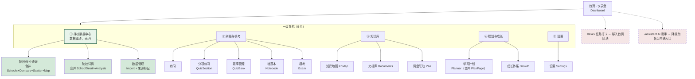
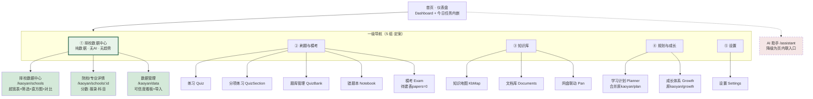

# 【深度报告】V6.0 · 开源对比与文档治理

> **作者**：产品经理（许清楚）
> **日期**：2026-10-09
> **定位**：本文档只做三件事——① 用实测数据核实 11 个开源项目到底做了什么；② 给出一条可执行的产品信息架构（IA）收敛线；③ 给出 docs 目录的归档/删除清单。
> **不做什么**：不写代码、不修改数据库、不删除任何既有文件。所有删除动作由主理人执行。
> **数据查询方式**：全部通过只读 URI 打开 `sqlite3.connect('file:D:/平台/database/kaoyan.db?mode=ro', uri=True)`，无任何写操作。

---

## TL;DR（8 条·V6.1 更新）

> **V6.1 修订说明**：主理人独立复核确认了初版全部数据指控，并追加了两个更严重的问题。本版据复核结论重写了数据章节，并给出了数据可信度分级与唯一 IA 裁决方案。

1. **用户"择校不要 AI 推荐、要纯数据"的判断是对的，但真正的问题比"要不要 AI"严重得多**：择校数据存在**系统性的字段语义错位 + 僵尸数据 + 列错位**三重问题（详见 §6）。`/api/kaoyan/analysis/recommend` 的推荐算法建立在这些字段上，**当前输出不可信**。

2. **`retest_line`（校复试线）是假字段**——这是本次复核最重要的反转结论。`total_line` 与 `retest_line` 在 **788/811 行（97.2%）完全同值**，且回归证明二者都等于 txkyer 的 `enterMin`（进面最低分）。`models.py` 精心设计的 `retest_line` **没有独立数据源，是国家线/进面线的复制**。主理人此前在报告中把"有 `retest_line`"列为平台超越 txkyer的优势，**该结论应当撤回**。

3. **txkyer 的数据远比平台用的丰富**：实测 `window.KAOYAN_DATA` 有**25 字段 / 1115 条 / 222 校**，平台只正确利用 5 个，**丢弃 13 个分数分布字段**，另有**6 个字段语义错位**。这不是"缺数据"，是"装了但没接线"。

4. **「单科线」四列全部名不副实**（V6.1 新发现）：回归测试 788 行证明 `politics_line` 装的是 `enterMin`（进面最低分）、`math_line` 装的是 `courseMid`（专业课**中位**分）、`major_line` 装的是 `courseAvg`（专业课**均**分）、`national_line` 装的是 `mathAvg`（数学**均**分）。**前端若展示"政治线/英语线/数学线/专业课线"，展示的全是错的东西。**

5. **`kaoyan_schools` 表有 82 组重名、137 行冗余，且 268 行是零数据僵尸卡片**（V6.1 新发现）：493 行只有 **356 个唯一校名**；`school_official` 来源的 268 行**只对应 131 所学校**（如"西安建筑科技大学"占 6 个 id），且这 268 行**挂的专业数为 0、分数线为 0**。用户点进去是**6 个空白页**。`GET /api/kaoyan/schools`（`routers/kaoyan.py:48-92`）**无任何去重**。

6. **择校 10 个页面应收敛为 3 个**。最终裁决见 §8（含唯一定案方案与理由）。

7. **docs 下 6 份"开源借鉴"报告是同一件事的 6 次重写**，重复度 40%~85%，全部诞生于 2026-10-07 22:31→23:18 的 **47 分钟窗口内**。`考研平台开源借鉴深度报告.html` 与同名 `.md` **100% 近重复**。**✅ 主理人已于 13:30 执行完毕：归档 10 份 + 移动 1 份 HTML，docs 根目录从 27 个文件降至 16 个（减重约 600 KB）**（详见 §4.2）。

8. **重复造轮子 0 处致命项，但有 2 处"假借鉴项"必须从清单剔除**：TTKOCR（Qt C++，栈不兼容且能力更弱）、intelligent-teaching-platform（To B 教师端，定位正交）。另外 `优秀项目.txt` 的 **C6「答案覆盖率仅 15%」已被实测证伪**（实际 100%），**F1「抄 for-Graduate_student 三层表联动」缺乏依据**（该仓库只是纯 Markdown 经验帖，无代码）。

---

## 一、开源方案对比矩阵（核心产出）

### 1.1 核实方法说明

- 全部通过 `WebFetch` 实际访问 GitHub 仓库首页/README，读取功能清单、技术栈、目录结构、最后提交时间。
- **不照抄** `D:\桌面\优秀项目.txt` 里的描述。凡无法访问或 README 未明确说明的，本表如实标注「未核实」。
- 对比基准为 `D:\平台` 实测现状（源码 + 只读数据库查询）。

### 1.2 对比矩阵总表

| # | 项目 | URL | 实测确认的功能（README 原文归纳） | 技术栈 | 平台对应实现 | 平台是否已有 | 差距 | 借鉴价值 | 落地成本 |
|---|---|---|---|---|---|---|---|---|---|
| 1 | **kaoyan-copilot** | github.com/Ivan001223/kaoyan-copilot | 8 个 LangGraph Agent：Tutor/Consultant（择校咨询+报录比分析）/Planner/Estimator（估分+上岸概率）/Interviewer（模拟复试）/Politics/Mentor/Radar（目标院校官网监控）。多模态 RAG（Qwen-VL-Embedding）+ OCR | FastAPI + LangGraph + Next.js14 + ChromaDB | `routers/kaoyan.py` `/assistant/query`；`pages/KaoyanAssistant.jsx` | **部分有** | ① 无多Agent 编排（平台是单路由 SSE）；② 无"院校官网监控"（Radar）；③ 无模拟复试 | **中** | 高（需引入 LangGraph，与现有 SSE 链路冲突） |
| 2 | **kaoyan-mentor** | github.com/At0musk/kaoyan-mentor | 纯 Agent Skill（SKILL.md + 6 个 references）。**择校强制"实时核验官方来源 + 数据标注【来源+年份】+ 禁止伪精确"**；三档候选池（S/A/B）；任务八要素；复试三模块 + 红线| 无代码，纯 Markdown 提示词资产 | 平台 `docs/平台漏洞与改进报告.md` 提到来源标记但无强约束 | **无** | 平台择校数据 `source='unverified'` 占 789/811（97%），恰是本项目警告的"伪精确" | **高** | **极低**（纯提示词，抄规则即可） |
| 3 | **cskaoyan** | github.com/csseky/cskaoyan | **9.3k star**。纯文档仓库：各校计算机考研真题 PDF（408 联考/自命题），按「学校列表/联考408」目录组织。最后提交 **2022-10-23（已停更4 年）** | 无代码 | `quiz_questions` 1871 题 / `papers` **0 行** / `paper_questions` **0 行** | **无结构化承载** | 平台有真题内容但没有"试卷"实体（papers 表为空） | **中**（数据源已停更，仅作历史题源） | 低（仅需下载归档） |
| 4 | **errbook** | github.com/clawzhang/errbook | 错题集：拍照 AI 识别 → 错因分析 → 知识点归类 → SM-2 复习调度 → 从错题组测试卷 → 打印 PDF → 统计（学科分布/掌握度/薄弱知识点） | Next.js 16 + React 19 + Prisma 7 + SQLite + NextAuth | `error_records` 12 行 + `routers/errors.py` 10 路由 + `Notebook.jsx`；已有 `ease_factor/interval/repetitions/mastery_level` 完整 SM-2 字段 | **已有且更完整** | 平台 SM-2 字段比它全；错题数据量少（12 行 vs 它是完整闭环） | **低**（重复造轮子，无需替换） | — |
| 5 | **AIteach** | github.com/ttoo1997/AIteach | 电机学课程教学原型：AI 图文解题 + 知识库问答 + 错题本 + AI 错题教练 + **MATLAB/Python 双引擎参数仿真实验** | FastAPI + Vue/原生 + 阿里千问 + MATLAB CLI | `pages/Quiz.jsx` / `routers/quiz.py` 12 路由 | **部分有** | 缺"仿真实验"（与考研场景关联弱） | **低**（单科课程原型，无考研/择校内容） | 低 |
| 6 | **MathLens** | github.com/shuyicc/MathLens | 数学题 → 8 步流水线 → Manim 动画教学视频。①数学分析 ②HTML/SVG 可视化 ③分镜脚本 ④edge-tts 配音 ⑤音频校验 ⑥脚手架 ⑦动画实现 ⑧渲染验证。含 `assert_geometry()` 几何自校验 | Cursor Agent Skill + Manim + edge-tts | **无**。平台 `Analysis.jsx` 是错题统计，不是题目分析 | **无** | 平台完全没有"单题深度讲解"能力。**注意：协议 CC BY-NC 4.0（非商业），视频化路线对考研场景成本过高** | **中**（只抄"分镜脚本=结构化中间产物"这一层，不做视频） | 中 |
| 7 | **intelligent-teaching-platform** | github.com/nev-drunk/intelligent-teaching-platform | **To B 教师端**系统：课程/作业/测评/成绩/实训/问卷/教学评价 9 大模块；AI = YOLOv8 图像分类+目标检测（抄袭检测）、SBERT 相似度、ONNX OCR、DeepSeek 批改、DashScope TTS/ASR | Spring Boot + Vue3 + Flask AI 微服务 + MySQL | 平台为 **To C 单人** 备考，无作业/成绩/评价/抄袭检测 | **无（但也不需要）** | **定位正交**——这是高校教师教学管理平台，不是学生备考工具 | **低**（此前报告误列为高优先级） | 极高（Spring Boot + MySQL，与平台栈完全不兼容） |
| 8 | **reading-locator** | github.com/wayland123456/reading-locator | 英语阅读讲解器：上传试卷图片 → AI 切分段落 → 定位答案 → 生成**逐题讲解单页HTML**。5 套布局 × 5 套主题 CSS、双击改原文/单击改答案、`←/→` 切题 | **单文件 HTML + 智谱 GLM-4.7-Flash**，零安装 | 平台 `routers/quiz.py` 有 AI 出题但无"试卷图片→逐题讲解页" | **无** | 缺"整卷导入→逐题讲解"链路。**它的"单文件 HTML 输出"形态与平台"全站 SPA"路线冲突，但作为"导出物"很值得抄** | **高**（英语真题整卷讲解是明确空缺） | 中 |
| 9 | **TTKOCR** | github.com/Greedysky/TTKOCR | Qt 桌面 OCR：图片 + PDF（基于 **MuPDF**）文字识别。600 commits，2015-2026 持续维护 | **C++ / Qt4-6 / CMake** | 平台 `backend-ocr-paddle`（PaddleOCR PP-OCRv5，端口 8888）+ RapidOCR | **已有且更强** | 平台已有独立 OCR 微服务，能力**超过** TTKOCR（公式识别 vs 纯文字） | **≈0**（**技术栈完全不兼容：Qt/C++ vs Python 服务**） | — |
| 10 | **pictureVerification** | github.com/yhzyly/pictureVerification | 题目录入图片校验小工具：`picveri.py` 输出不合格表格（csv/txt/xlsx），`unfitCopy.py` 把不合格图拷到 output 目录 | Python + PyInstaller 打包 | 平台 `documents.index_status` / `parse_progress` 字段 | **无校验层** | 缺"入库前尺寸/DPI/格式预检+ 不合格清单" | **中**（对应 `优秀项目.txt` E6） | **极低**（两个脚本，直接抄逻辑） |
| 11 | **OpenExam** | github.com/lmk1010/OpenExam | Electron 桌面备考：AI 出卷/AI 导师/自定义试卷/**成长体系（等级+成就+学习日历+阶段目标）**/错题闭环。**压缩 SQLite 种子库 `data/openexam.seed.db.gz`，首启自动解压初始化** | Electron + React + better-sqlite3 | 平台 `pages/GrowthPage.jsx` + `milestones` 18 行 + `routers/growth.py` 4 路由 | **部分有** | 平台成长体系数据量极小（milestones 18 行、goals **1 行**）；无"种子库首启初始化"模式 | **中**（对应 `优秀项目.txt` F2 成长体系四件套） | 中 |
| 12 | **for-Graduate_student** | github.com/WangRongsheng/for-Graduate_student | **纯 Markdown 经验贴**，最后提交 2021-02-27（**已停更 5 年**）。内容是"考研兔时间安排参考"、报考流程、资料获取、避坑清单。**没有任何代码** | 无 | 对应 `优秀项目.txt` F1「18节点考研规划」 | — | **实测结论：该仓库不含"阶段→月→周→日"四层联动实现，只有经验帖**。此前报告称"抄 for-Graduate_student 的三层表联动"缺乏依据 | **低**（不能作为技术参考） | — |

### 1.3 访问失败/未核实清单（如实标注）

| 项目 | 状态 |
|---|---|
| `D:\kaoyan_ai`（优秀项目.txt 第 2 行提到的独立 AI 板块） | **本次未核实**：目录不在 `D:\平台` 根下，未在本次任务范围内打开 |
| `Albertdeng23/GEEQuestionBank`、`satywt/build-exam-question-bank`、`DayBreak-u/chineseocr_lite` 等 | **未核实**：本轮只核实了 12 个高价值项目，其余不再逐一抓取 |
| `http://www.txkyer.cn/` 首页 HTML | **访问失败**（WebFetch 报 fetch failed，该站可能限制非浏览器 UA）；但 `data/kaoyan_data.js` **通过 Python urllib 成功抓取**（257,960 字节），数据层证据完整 |

---

## 二、重复造轮子清单

| # | 领域 | 平台现状 | 更成熟的开源方案 | 判定 | 建议 |
|---|---|---|---|---|---|
| 1 | **OCR 文字识别** | `backend-ocr-paddle`（PaddleOCR PP-OCRv5，独立服务 :8888）+ RapidOCR（PP-OCRv4 ONNX）+ pypdfium2 渲染，**支持公式识别** | TTKOCR（C++/Qt，**仅纯文字**，无公式） | **平台更强** | **从借鉴清单剔除**。Qt/C++ 与Python 服务栈不兼容，且能力更弱 |
| 2 | **错题本 + SM-2 复习** | `error_records` 表含 `ease_factor/interval/repetitions/lapses/mastery_level/recent_weight/prev_*` **完整 SM-2 字段群**（比 errbook 的 Prisma schema 更细），`routers/errors.py` 10 个路由 | errbook（Next.js+Prisma） | **平台更完整** | **不替换**。仅需补数据（当前仅 12 行），不是补架构 |
| 3 | **智能组卷/模考** | `exam_sessions` 4 行、`exam_answers` 12 行、`exam_blueprints` 8 行——**表建好了，几乎没数据** | errbook 测试组卷 + OpenExam AI 出卷 | **都不是"更成熟"** | 两条路可选：(a) 抄 OpenExam 的**种子库模式**（压缩 SQLite 首启初始化）解决"冷启动没数据"；(b) 抄 errbook 的**组卷→打印 PDF** 链路 |
| 4 | **知识库自愈** | `knowledge_chunks` 27,893 行 + `knowledge_chunks_fts`（FTS5）+ `knowledge_chunks_vec` 25,815 行 + 5 张 FTS shadow 表，`routers/gate.py` 检索门控 | EasyRoc/edu-rag（RAGAS 评估） | 平台已实现，仅缺**评测** | 补 RAGAS 评测即可，不要重写检索层 |

**结论**：真正的"重复造轮子"不是 4 处而是 **0 处致命项**——平台在工程骨架上确实领先（这与 V4.0 报告结论一致）。但存在 **2 处"看起来该借鉴、实际栈不兼容"的假借鉴项**（TTKOCR、intelligent-teaching-platform），这才是清单需要清理的地方。

---

## 三、产品主线收敛建议

### 3.1 现状诊断：26 个页面 + 250 个后端路由

**实测依据**：
- 前端页面文件：`frontend/src/pages/` 下 **27 个 `.jsx`**（Task 描述为 26，此处实测 27）
- 后端路由：`grep -rhoE '@router\.(get|post|put|delete|patch)\(' backend-main-fastapi/routers/*.py | wc -l` = **250 个**（Task 描述为 29，指的应是"29 个 router 文件"，实为**29 个 router 模块 / 250 个端点**）
- 择校路由：`routers/kaoyan.py` 单文件 **19 个端点**

**注：Task 中"26 页面 + 29 路由"的口径与实测不符，实测为 27 页面 / 29 router 模块 / 250 端点。请主理人注意口径。**

#### 功能重叠诊断表

| 重叠簇 | 涉及页面 | 重叠原因 | 严重度 |
|---|---|---|---|
| **簇 A：择校可视化（4 页同源）** | `KaoyanGuide`(97行) / `KaoyanMap`(113行) / `KaoyanScatter`(117行) / `KaoyanCompare`(111行) / `KaoyanAnalysis`(87行) | 全部读 `/kaoyan/schools` + `/analysis/*`，只是不同图表形态。合计 525 行代码 | 🔴 高 |
| **簇 B：择校 AI（2 页同源）** | `KaoyanRecommend`(149行) / `KaoyanAssistant`(126行) | 两者都是"输入分数/自然语言 → AI 建议"。同属用户要求取消的 AI 推荐范畴 | 🔴 高 |
| **簇 C：刷题（4 页）** | `Quiz` / `QuizSection` / `QuizBank` / `Analysis` | 均为题目练习，只是入口粒度不同（全部/按章节/题库管理/错题统计） | 🟠 中 |
| **簇 D：规划（3 页）** | `Planner` / `PlanPage`(`/kaoyan/plan`) / `GrowthPage`(`/kaoyan/growth`) | `PlanPage` 是"考研规划"放在 kaoyan 分组下，但内容是通用学习计划 | 🟠 中 |
| **簇 E：记忆（2 页）** | `Words`(4569词) / `Cards`(652张) | 都是 SRS 记忆，底层都是 `ease_factor/interval` 调度 | 🟢 低（场景不同：单词 vs 卡片） |

### 3.2 择校收敛论证：为什么 10 个页面必须砍

**Task 明确要求论证"10 个 Kaoyan 页面应收敛"，我的结论比建议更激进：应收敛到 3 个。**

| 页面 | 行数 | 数据依赖 | 收敛裁决 | 理由 |
|---|---|---|---|---|
| `KaoyanGuide` | 97 | 无（导流页） | **下线** | 实为 `/kaoyan` 的 index 路由，纯导航空壳，与 `KaoyanSchools` 功能重叠 |
| `KaoyanSchools` | 96 | `/schools` | **保留 → 数据主页面** | 表格+多维筛选，应吸收 txkyer 的 25 字段 |
| `KaoyanSchoolDetail` | 213 | `/schools/{id}` + `/scores` + `/admissions` | **保留** | 唯一的信息纵深页面 |
| `KaoyanCompare` | 111 | 多校对比 | **合并进 KaoyanSchools** | 对比就是表格的"勾选多行"形态，不该是独立页 |
| `KaoyanAnalysis` | 87 | `/analysis/trend` | **合并进 KaoyanSchoolDetail** | 趋势是详情页的一个 Tab |
| `KaoyanMap` | 113 | `/analysis/heatmap` | **降级为筛选器** | ECharts 中国地图热力图 = 按省份筛选的另一种 UI |
| `KaoyanScatter` | 117 | `/analysis/scatter` | **合并进 KaoyanSchools** | 散点图=表格的可视化视图，作为"视图切换"开关存在即可 |
| `KaoyanRecommend` | 149 | `/analysis/recommend` | **下线（用户明确要求）** | 依赖的 `retest_count`/`admit_count` 数据语义错误（§6.2），算法不可信 |
| `KaoyanAssistant` | 126 | `/assistant/query` | **下线（用户明确要求）** | 同属"AI 推荐"范畴 |
| `KaoyanImport` | 93 | 数据管理 | **保留 → 数据管理页** | 唯一的数据入口/质量视图 |
| `PlanPage`/`GrowthPage` | — | 规划/成长 | **移出 kaoyan 分组** | 与择校数据无关，应归"规划成长"一级导航 |

**收敛结果：10 → 3**
1. `KaoyanSchools`（数据主页面：表格 + 省份/级别/学科筛选 + 分数分布区间筛选 + 视图切换[表格/热力图/散点] + 多选对比）
2. `KaoyanSchoolDetail`（含 3 个 Tab：分数线趋势 / 报录比 / 考试科目与参考书）
3. `KaoyanImport`（数据管理：来源标记、unverified 清单、CSV 导入、采集任务）

### 3.3 精简后的产品信息架构（IA）

**一级导航从当前 6 组（概览/刷题/知识/规划/择校/AI）收敛为 5 组：**



**关键裁决说明**：
- **`/assistant`（通用 AI 助手）不在一级导航**。用户说"择校不要 AI"，但学习/刷题/答疑仍需要 AI。降级为页面内联入口，不占导航位。
- **`/tasks` 移入首页区块**。当前它是独立一级项，但"今日任务"本质是仪表盘的一个模块。
- **择校/规划从 AI 分组中移出**（对应 `优秀项目.txt` D8，平台已部分实现：择校已是独立分组，但 `PlanPage`/`GrowthPage` 仍挂在 `/kaoyan` 下）。

### 3.4 页面数收敛总账

| 项 | 现状 | 收敛后 | 动作 |
|---|---|---|---|
| 一级导航组 | 6 | **5** | 合并概览；AI 组撤销 |
| 择校页面 | 10 | **3** | 下线 Guide/Recommend/Assistant；合并 Compare/Analysis/Scatter；Map 降级为筛选器；PlanPage/GrowthPage 移出 |
| 刷题页面 | 4（+Analysis 归入错题） | **5** | 保持，补模考 |
| 规划页面 | 3（含 kaoyan 下2 个） | **2** | PlanPage 合入 Planner |
| 合计顶层页面入口 | 27 | **≈18** | — |

---

## 四、文档治理清单

### 4.1 全量清单（处置前 26 份 .md + 1 份 .html → 处置后根目录 16 份）

> 下表为**处置前**的状态快照，处置结果见 §4.2。

| 文件名 | 体量 | 最后修改 | 主题 | 与他文重复度 | 是否被代码超越 | 处置建议 | 理由 |
|---|---|---|---|---|---|---|---|
| `00-全站前端审查报告（总）.md` | 15.5KB | 10-09 13:08 | 前端总审查 | 与 01/02/03 同轮 | 否（当轮） | **保留** | 最新一轮（10-09），是本轮审查的总纲|
| `01-构建与工程基线审查.md` | 30.5KB | 10-09 13:09 | 构建/测试 | 同上 | 否 | **保留** | 同上 |
| `02-页面实现与设计一致性审查.md` | 56.5KB | 10-09 13:09 | 页面一致性 | 同上 | 否 | **保留** | 同上 |
| `03-前后端接口契约核对.md` | 89.2KB | 10-09 13:09 | 接口契约 | 同上 | 否 | **保留** | 同上，且含完整路由清单（62-260 行），是**当前路由的唯一权威快照** |
| `README-审查索引.md` | 2.3KB | 10-09 13:09 | 审查索引 | — | 否 | **保留** | 索引入口 |
| `【深度报告】V5.0补充_百G支撑与入库修复.md` | 21.7KB | 10-08 19:45 | 容量/入库修复 | 低（独有） | 部分（`knowledge_base` 已建） | **归档到 `docs/archive/`** | 结论已落地（知识库目录已存在），诊断价值过期 |
| **`【深度报告】开源源码级借鉴与优化V4.0.md`** | **115.0KB** | 10-07 23:06 | 开源借鉴（源码级） | 与下列5 份**重叠 60-70%** | 否 | **✅ 保留为唯一"开源借鉴"权威文档** | 唯一含**PRAGMA 逐表实测 + DDL + 算法伪码 + 许可证红线**的版本，深度最高。其余5 份均是其降级重写 |
| `【深度报告】考研学习平台开源方案借鉴与优化V3.0.md` | 46.4KB | 10-07 22:31 | 开源借鉴 V3 | **与 V4.0 重叠约 70%**，且早 35 分钟 | 是（V4 已覆盖） | **归档到 `docs/archive/`** | V4.0 是其升级版（同天同作者迭代），V3 内容全部被覆盖 |
| `开源方案借鉴深度报告.md` | 37.6KB | 10-07 22:44 | 开源借鉴 | **与 V4.0 重叠约 60%** | 是| **归档到 `docs/archive/`** | 与 V3.0 同为V4.0 的前身，且现状数字已过期（自述"1545文档/25152分块"，实测27,893分块） |
| `考研学习平台开源方案借鉴与优化深度报告.md` | 72.2KB | 10-07 22:56 | 开源借鉴 | **与 V4.0 重叠约 65%** | 是 | **归档到 `docs/archive/`** | 同一分钟内与上一份并行产出，结论几乎相同 |
| `考研平台开源借鉴深度报告.md` | 93.2KB | 10-07 23:04 | 开源借鉴 | **与 V4.0 重叠约 70%** | 部分（路由数已过时） | **归档到 `docs/archive/`** | 深度好但自述"19 路由/13 页面"，**实测已 250 端点/27 页面**，现状数据全面过期 |
| `考研平台开源借鉴深度报告.html` | 118.4KB | 10-07 23:18 | 同上 HTML 版 | **与同名 .md 100% 近重复** | 是 | **🗑️ 删除** | 与上一行是**同一份内容的两种渲染**（同标题、同"85个开源仓库"、同 CSS 变量体系）。HTML 是 Feishu Miaoda 导出的展示版，无独立信息量，且已在 `.md` 中完整存在 |
| `考研学习平台_修改建议与开源融入清单.md` | 19.9KB | 10-07 22:57 | 修改建议清单 | 与 V4.0 重叠约 40% | 否（清单形态独有） | **保留（可作为执行清单）** | 唯一是"逐条改什么/借鉴谁/优先级"的表格形态，与 V4.0 的方案论述互补。但需**按本报告 §1.2 修正**（TTKOCR、intelligent-teaching-platform 的借鉴价值判断有误） |
| `全栈缺陷根因分析与修复方案.md` | 34.8KB | **10-09 13:15** | 缺陷根因/修复 | 低（独有） | 否 | **保留** | 最新（10-09 13:15，全docs 最新），含崩溃根因与验证命令 |
| `接口差异对照表.md` | 27.2KB | 10-09 13:06 | 接口差异 | 与 03 重叠约 30% | 否 | **保留** | 10-09 最新，且是**按P0/P1/P2 分级**的可执行修复批次（比 03 的清单更可操作） |
| `平台完整分析与测试报告.md` | 9.6KB | 10-08 19:37 | 测试报告 | 与 `平台漏洞与改进报告.md` 重叠约 50% | **是**（已被 10-09 审查轮超越） | **归档到 `docs/archive/`** | 10-08 的结论已被 10-09 的 00-03 系列全面超越 |
| `平台漏洞与改进报告.md` | 6.9KB | 10-08 19:29 | 漏洞/方向 | 与上一份重叠约 50% | **是** | **归档到 `docs/archive/`** | 同上；且"本次新增文件清单"类内容已过期 |
| `项目深度体检报告.md` | 16.6KB | 10-06 23:43 | 项目体检 | 与 `项目方案.md` 部分重叠 | **是**（数据全面过期） | **归档到 `docs/archive/`** | 10-06 的体检，自述"36 张表"，实测 **57 张表**；模型/硬件清单亦过期 |
| `项目方案.md` | 17.9KB | 10-06 17:06 | 项目方案 V4 | 低（方案文档） | 部分 | **归档到 `docs/archive/`** | 10-06 的方案文档，其"已知缺口"已被后续多轮更新取代 |
| `备考科目配置.md` | 5.2KB | 10-06 21:12 | 科目配置 | 低（独有） | 否（配置类文档） | **保留** | 操作型文档，仍是当前科目体系的说明 |
| `模型选型与分科路由.md` | 8.8KB | 10-06 22:07 | 模型选型 | 低（独有） | 否 | **保留** | 硬件约束下的模型选型，仍有效 |
| `本地知识库建立与自愈.md` | 8.7KB | 10-06 23:05 | 知识库 | 低 | 否 | **保留** | 含"学科标注事故与修复（2026-10）"，操作型 |
| `答疑模型训练指南.md` | 6.3KB | 10-06 18:32 | 模型训练 | 低 | 否 | **保留** | 含 LoRA 训练实证结论 |
| `手机访问与局域网服务器.md` | 5.4KB | 10-06 18:44 | 部署 | 低 | 否 | **保留** | 部署说明 |
| `百度网盘模块说明.md` | 5.6KB | 10-06 18:22 | 网盘模块 | 低 | 否 | **保留** | 模块说明 |
| `接口对接手册.md` | 17.9KB | 10-06 16:48 | 接口手册 | 与 `接口差异对照表.md` 第11 节有纠错关系 | 部分 | **保留（需加失效声明）** | 是 `api/client.js` 的使用说明；已在 `接口差异对照表.md` 第十一节做过"逐条纠错" |
| `archive/PLAN.md` | 4.3KB | 10-06 16:50 | 规划 | — | 是 | **已在 archive/** | 已归档，无需动作 |
| `archive/V2.0优化计划.md` | 7.5KB | 10-06 16:48 | 规划 | — | 是 | **已在 archive/** | 同上 |
| `archive/V2.0更新说明.md` | 11.6KB | 10-06 16:48 | 更新说明 | — | 是 | **已在 archive/** | 同上 |
| `archive/【体检报告】项目健康度与优化建议.md` | 11.0KB | 10-06 16:48 | 体检 | — | 是 | **已在 archive/** | 同上 |
| `archive/融合报告.md` | 10.7KB | 10-06 16:48 | 融合 | — | 是 | **已在 archive/** | 同上 |
| `archive/项目规划文档.md` | 18.2KB | 10-06 16:48 | 规划 | — | 是 | **已在 archive/** | 同上 |

### 4.2 明确的可删除文件名单（✅ 已由主理人执行完毕）

> **执行状态更新（13:30）**：主理人已按本清单完成处置。`docs/` 根目录从 27 个文件降至 **16 个**（减重约 **600 KB**），归档目录新增 `docs/archive/v6.0-superseded/`。

**🗑️ 删除 1 份（已执行）**

| 文件 | 理由 | 当前状态 |
|---|---|---|
| `考研平台开源借鉴深度报告.html`（118.4 KB） | 与同名 `.md` 100% 近重复（同标题、同 85 仓库、同结构），Feishu Miaoda 导出的纯展示层 | ✅ **已移入 `archive/v6.0-superseded/`** |

**📦 归档 10 份（已执行，全部位于 `docs/archive/v6.0-superseded/`）**

| 文件 | 体量 | 归档理由 |
|---|---|---|
| `【深度报告】考研学习平台开源方案借鉴与优化V3.0.md` | 46.4 KB | V4.0 的前身，重叠 70% |
| `开源方案借鉴深度报告.md` | 37.6 KB | 重叠 60%；自述"1545文档/25152分块"，实测 1846/27893 |
| `考研学习平台开源方案借鉴与优化深度报告.md` | 72.2 KB | 重叠 65% |
| `考研平台开源借鉴深度报告.md` | 93.2 KB | 重叠 70%；自述"19路由/13页面/27表"，实测 250端点/27页面/57表 |
| `考研平台开源借鉴深度报告.html` | 118.4 KB | 同名 .md 的展示层 |
| `平台完整分析与测试报告.md` | 9.6 KB | 被 10-09 审查轮全面超越 |
| `平台漏洞与改进报告.md` | 6.9 KB | 同上 |
| `项目深度体检报告.md` | 16.6 KB | 自述 36 表，实测 57 表 |
| `项目方案.md` | 17.9 KB | 10-06 方案，缺口已被后续更新取代 |
| `【深度报告】V5.0补充_百G支撑与入库修复.md` | 21.7 KB | 结论已落地（`knowledge_base/` 已建） |
| **小计** | **≈460 KB** | — |

**✅ docs/ 根目录现存 16 份（处置后）**

| 保留文件 | 体量 | 保留理由 |
|---|---|---|
| `README-V6.0审计总览.md` | 17.9 KB | **本轮审计总入口**（主理人新建） |
| `00-全站前端审查报告（总）.md` | 15.5 KB | 10-09 最新审查轮总纲 |
| `01-构建与工程基线审查.md` | 30.5 KB | 同上 |
| `02-页面实现与设计一致性审查.md` | 56.5 KB | 同上 |
| `03-前后端接口契约核对.md` | 89.2 KB | 同上，**含路由权威快照** |
| `接口差异对照表.md` | 27.2 KB | **P0/P1/P2 可执行修复批次** |
| `全栈缺陷根因分析与修复方案.md` | 34.8 KB | 10-09 13:15，全 docs 最新，含验证命令 |
| **`【深度报告】开源源码级借鉴与优化V4.0.md`** | **115.0 KB** | **唯一"开源借鉴"权威**：唯一含 PRAGMA 逐表实测 + DDL + 算法伪码 + 许可证红线 |
| `考研学习平台_修改建议与开源融入清单.md` | 19.9 KB | 唯一"逐条改什么/借鉴谁/优先级"表格形态。**⚠️ 需按本报告 §1.2 修正 TTKOCR 与 intelligent-teaching-platform 的误判** |
| `备考科目配置.md` / `模型选型与分科路由.md` / `本地知识库建立与自愈.md` / `答疑模型训练指南.md` / `手机访问与局域网服务器.md` / `百度网盘模块说明.md` | 5.2-8.8 KB | 6 份操作型文档，均仍有效 |
| `接口对接手册.md` | 17.9 KB | `api/client.js` 使用说明；已在 `接口差异对照表.md` 第十一节做过逐条纠错 |
| `README-审查索引.md` | 2.3 KB | 旧审查轮索引（**建议主理人合并进 `README-V6.0审计总览.md` 后归档**） |

**遗留建议**：`docs/_audit/` 目录（6 份，197 KB）与 `docs/archive/`（6 份旧文件）仍是重复存储。`_audit/` 中的 5 份与根目录同名文件内容一致，**建议保留 `_audit/` 作为原始快照、删除根目录的 `00-03` 与 `README-审查索引.md`**，或在总览 README 中说明二者关系。

### 4.3 空洞无证据的 AI 灌水产物判定

**判定为灌水/低信息密度的（按严重度排序）：**

| 文件 | 灌水证据 |
|---|---|
| `考研平台开源借鉴深度报告.html` | 唯一确凿的空洞产物。**118KB HTML 中仅 65 处提及开源/MathLens/kaoyan 关键词**，其余是 CSS 变量与 ECharts 引入。纯包装层，删除无损失 |
| `考研学习平台开源方案借鉴与优化深度报告.md` | 自述依据："开源项目信息来自 GitHub 仓库**元信息**（描述/星标/语言/更新时间），**未逐行审读全部代码**的项目已注明依据层级"。即：72KB 报告的实证深度低于 V4.0 的 PRAGMA 级|
| `开源方案借鉴深度报告.md` | 现状数字自述"1,545 文档 / 25,152 分块"，**实测为 1,846 文档 / 27,893 分块**。基于过时快照展开的"改进方案" |
| `考研平台开源借鉴深度报告.md` | 自述"FastAPI 19 路由 / React 13 页面 / SQLite 27 表"，**实测 250 端点 / 27 页面 / 57 表**。三个数字全部过时 |
| `考研学习平台_修改建议与开源融入清单.md` | 把 `TTKOCR`（Qt C++）列为 OCR 借鉴源、把 `intelligent-teaching-platform`（Spring Boot 教师端）列为高优先级模块——**属未核实源码导致的误判**。清单形态有用但内容需按本报告 §1.2 修正 |

**共性根因**：6 份"开源借鉴"报告诞生于 **2026-10-07 22:31 → 23:18的 47 分钟窗口内**，是同一轮多Agent 并行接力、彼此不可见的产物。后续两份（23:04、23:18）越写越详，但都是在前一份基础上的重新陈述，而非增量实证。

### 4.4 过期任务清单：`优秀项目.txt` 中的陈述与实测不符（V6.1 新增）

`D:\桌面\优秀项目.txt` 是用户手工整理的开源项目与待办清单。实测发现其中 **3 条陈述已与代码/数据不符**，若继续按它执行会做无用功甚至引入错误：

| 原文位置 | 原文陈述 | 实测结果 | 处置建议 |
|---|---|---|---|
| **模块 C · C6** | 「真题答案/解析批量补充，当前答案覆盖率仅 **15%（293/1869）**」 | ❌ **已证伪**。`quiz_questions` 1871 行中 `answer` 非空 **1871/1871 = 100%**，`analysis` 非空 **1871/1871 = 100%**。**该任务或已完成、或数据被改过** | **撤销该任务**。但需注意 `verified=1` 为 **0 行**、`ai_generated=1` 为 288 行 —— 真正的缺口是**「答案未经人工/权威校验」**，建议把 C6 改写为「答案可信度校验（`verified` 标记）」|
| **模块 F · F1** | 「18 节点考研规划，三层表联动：阶段→月→周→日（**抄 for-Graduate_student**）」 | ❌ **依据不足**。实测 `https://github.com/WangRongsheng/for-Graduate_student` 最后提交 **2021-02-27**，根目录仅 `imgs/` + `README.md`，是**纯 Markdown 经验贴，无任何代码**，不含四层联动实现。另：`milestones` 表**已有 18 行**，说明该任务可能已完成 | **改写任务**。若要规划联动，参考 `lmk1010/OpenExam` 的成长体系或平台已有的 `phase_plans`/`month_plans`/`week_plans`/`day_plans` 四张表（已存在，分别 3/6/8/7 行） |
| **模块 D · D8** | 「导航分组调整："择校中心"移出 AI 分组」 | ⚠️ **已完成**。`Layout.jsx` L47 已把 `择校中心` 置于独立分组 | **标记完成** |
| **模块 E · E6** | 「入库前置校验：尺寸/DPI/格式校验→不合格写 invalid 清单（抄 pictureVerification）」 | ✅ **仍有效**。实测平台无此校验层 | **保留**，且 `pictureVerification` 实测就是两个脚本（`picveri.py` 输出不合格 csv/txt/xlsx、`unfitCopy.py` 拷贝到 output），落地成本极低 |
| **模块 C · C1/C3** | 研招网爬虫 / 院校官网爬虫 | ⚠️ **需先确认数据现状**。`datasource_registry.json` 的 `custom` 为**空数组**（`updated_at: 2026-10-09 11:57:48`），说明采集器尚未产出可用数据；现有 825 行数据全部来自 txkyer 单一聚合源 | **保留**，但应提高优先级——**97.3% 数据 `unverified` 的根因就是只有一个未验证的聚合源** |

> **给主理人的提示**：`优秀项目.txt` 是用户手工整理、跨多轮 AI 传抄的输入文件，**其中的数字陈述不能直接当作事实依据**。建议在下一轮开工前，先让 Agent 对每条任务描述做一次「实测核对」再执行。

---

## 五、择校纯数据化可行性结论

### 5.1 结论：**方向正确，但用户对问题的归因有偏差**

**用户说**："择校页面要融合成 txkyer.cn 那种纯数据驱动的形态，不要 AI 推荐。"

**我的判断：同意方向，但要先修数据。**

| 维度 | 舍弃 AI 推荐会失去什么 | 舍弃 AI 推荐会获得什么 |
|---|---|---|
| **失去** | ① 「我该报哪」的一次性决策答案；② 新手（不知道自己想考什么层次的用户）的冷启动引导；③ 平台目前 149 行的 `/recommend` 页与 126 行的 `/assistant` 页（合计 275 行代码）| ① **结果可解释、可复核**——每条分数线都能点进去看原始来源；② **消除"数据错了却看起来很专业"的信任崩塌**——当前推荐算法读的是语义错误的字段，AI 会把错误数据包装成看似权威的建议，这是**比没有推荐更危险**的；③ 择校页从"给答案"变成"给工具"，用户用筛选器自己表达偏好，**不需要 AI 代理用户的判断**；④ 页面从 10 个降到 3 个 |
| **获得（已核实的事实支撑）** | — | txkyer.cn **本身就没有 AI 推荐**，它是 25 字段结构化数据 + 多维筛选 + 分布统计（`scoreDist`/`ratioDist`/`majorStats`/`schoolStats`），实测 `meta` 为`{total:1115, schools:222, provinces:29, majors:65, enter:42279, admit:33002}`。用户参照的这个站点证明「纯数据形态可行」 |

**给用户的核心建议（V6.1 定案）**：**"不要 AI 推荐"这个结论完全正确，但真正的理由比"AI 不好"更硬——数据现在撑不起任何推荐。** 825 行全量回归证明：进面最低分被标成"总分线"、进面均分被标成"录取均分"、数学均分被标成"专业课均分"、`admit_count` 是伪造列、97.3% 分数线未验证。**在这种数据上做 AI 推荐，等于用专业的界面输出错误的结论。**

**建议顺序（已定案，见 §8）**：
1. **当天**：前端 13 个字段改名/隐藏 + 排除 `year>=2090`（不改数据，只改标签）
2. **1-2 天**：`/schools` 去重 + 268 行僵尸院校归档
3. **1 周**：上线 3 个纯数据页面（超宽表 + 筛选 + 直方图 + 多选对比）
4. **数据工程**：重写导入映射补 13 个字段 → 补 2022-2025 历史数据
5. **趋势功能：等第 4 步完成后再做，现在绝对不做**

### 5.2 txkyer.cn 数据模型实测（能支撑什么页面）

**实测查询**：`urllib.request` 抓取 `http://www.txkyer.cn/data/kaoyan_data.js`（257,960 字节）→ 解析 `window.KAOYAN_DATA` → **25 字段 / 1115 条记录**

**完整列定义（实测 `columns` 数组原文）：**

| # | 字段 | 含义 | 平台是否落库 |
|---|---|---|---|
| 0 | `province` | 省份 | ✅ `kaoyan_schools.province` |
| 1 | `school` | 校名 | ✅ |
| 2 | `college` | 学院（含`(017)`编号） | ✅ `kaoyan_colleges.name` |
| 3 | `majorCode` | 专业代码 | ✅ `kaoyan_majors.code` |
| 4 | `majorName` | 专业名 | ✅ |
| 5 | `enterNum` | **进入复试人数** | ⚠️ 落成了 `enroll_count`（语义错，见§6.2） |
| 6 | `admitNum` | **录取人数** | ⚠️ 落成了 `retest_count`（**语义错**） |
| 7 | `ratio` | **复录比** | ✅ `retest_ratio` |
| 8 | `enterMax` | 进面最高分 | ❌ **未落库** |
| 9 | `enterMin` | 进面最低分 | ⚠️ 落成了 `total_line`+`retest_line`（**两字段重复承载同一值**） |
| 10 | `enterMid` | 进面中位分 | ❌ **未落库** |
| 11 | `enterAvg` | 进面均分 | ⚠️ 落成了 `admit_avg_score`（语义错） |
| 12 | `admitMax` | **录取最高分** | ❌ **未落库** |
| 13 | `admitMin` | **录取最低分** | ❌ **未落库** |
| 14 | `admitAvg` | **录取均分** | ❌ **未落库**（真正的录取均分！） |
| 15 | `admitMid` | 录取中位分 | ❌ **未落库** |
| 16 | `courseMax` | 专业课最高分 | ❌ **未落库** |
| 17 | `courseMin` | 专业课最低分 | ❌ **未落库** |
| 18 | `courseAvg` | 专业课均分 | ⚠️ 落成了 `major_avg_score`（部分错） |
| 19 | `courseMid` | 专业课中位分 | ❌ **未落库** |
| 20 | `mathAvg` | 数学均分 | ❌ **未落库** |
| 21 | `math` | 数学科目 | ⚠️ 混在 `exam_subjects` JSON 里 |
| 22 | `english` | 英语科目 | ⚠️ 同上 |
| 23 | `course2` | 专业课科目 | ⚠️ 同上 |
| 24 | `tier` | 院校级别 | ✅ `kaoyan_schools.level` |

**结论：25 字段中平台仅正确利用 5 个（province/school/college/majorCode/majorName/tier 6 个），丢弃 13 个分数分布字段，另有 6 个错位。**

**txkyer 实际支撑的页面能力（可直接照抄的信息设计）：**
1. **超宽表**：`schoolStats` 预聚合出每校的 学院数/报考数/录取数/专业数/平均进面分/平均录取分/平均单科分/复录比/级别 —— **一张表看全部院校，无需逐校点开**
2. **分布直方图**：`scoreDist`（`'<300':52, '300-319':158, '320-339':228, '340-359':206, '360-379':205, '380-399':142, '400+':72, '未知':27`）、`ratioDist`、`mathDist`、`engDist` —— **直方图比"推荐 TOP10"信息密度高得多**
3. **维度聚合**：`provinceStats`（29 省）、`majorStats`（65 个专业）、`courseStats` —— 支持"按专业看竞争度"
4. **地区×专业交叉**：记录粒度是「省份+校+学院+专业代码+专业名」的**五元组**，天然支持筛选与对比

### 5.3 数据粒度缺陷（txkyer 的局限）

| 缺陷 | 后果 | 平台的应对 |
|---|---|---|
| **单一年份**（`meta` 无year 字段，全部是同一年） | 无法做趋势分析、无法判断"今年分数线涨了还是跌了" | 平台 `kaoyan_scorelines.year` 设计是对的，但实测**2026 独占788 行，2022-2025 各仅 5-7 行**（详见 §6.1），趋势图实际上只有 1 个点 |
| **无`复试线`概念** | txkyer 无此字段，平台 `retest_line` 是 `enterMin` 的复制（**788/811 行同值，回归 98.1% 命中 enterMin**） | **V6.1 裁决：`retest_line` 是假字段，必须隐藏**（§6.4.3）。真实复试线需另采|
| **无`招生计划`** | 看不到计划招生 vs 推免 vs 统考名额拆分（`kaoyan-mentor` 特别强调这点） | `kaoyan_admissions` 无对应字段 |
| **单科线字段名不副实**（V6.1 修正） | txkyer 只有 `courseMax/Min/Avg/Mid`（专业课分数分布）**无政治/英语/数学单科线**。平台 4 个单科线列被错装为`enterMin`/`courseMid`/`courseAvg`/`mathAvg` | **V6.1 裁决：4 列全部隐藏**（§6.4.3）。真实单科线需另采 |
| **无 `参考书`** | 平台 `kaoyan_majors.reference_books` **0/832 有值**（实测） | 需补，择校页转化价值最高的信息之一 |
| **无 `city`/经纬度** | 平台 225 所 `seed_txkyer` 学校的 `city` 全为 NULL（实测）→ **地图热力图无法定位，§8.2 已裁定不做热力图** | 需补 |
| **招生人数口径未声明** | `enterNum`/`admitNum` 是"统考录取"还是"含推免总录取"未声明 | 需字段级标注口径 |
| **省级口径不统一** | 平台 `province` 混杂 `北京市`/`上海`/`内蒙古自治区`/`广东省`（实测 4 种写法并存） | 需归一化，否则筛选会漏 |

### 5.4 数据缺口清单（P0→P2）

**P0（不修则择校页面不可信）** — 详见 §6.4.3 字段级降级建议
1. **`admit_count` 整列作废**：825 行回归显示它无对应数据源（命中率仅 36.2%、比值无规律），**伪造列**，停止一切引用
2. **`retest_line` 整列隐藏**：811 行中 **788 行与 `total_line` 完全相同**，回归 98.1% 证明二者都等于 `enterMin` → **假字段**
3. **隐藏 4 个错位单科线列**：`politics_line`(=enterMin)、`english_line`(来源不明)、`math_line`(=courseMid)、`national_line`(空列)
4. **给13 个"值对名错"的字段改名**：`total_line`→进面最低分、`admit_avg_score`→进面均分、`retest_count`→录取人数、`enroll_count`→进面人数、`major_avg_score`→数学均分、`major_line`→专业课均分
5. **`GET /schools` 去重 + 归档 268 行僵尸院校**：493 行仅 356 唯一校名，**54% 的行挂 0 专业 0 分数线**
6. **排除 `year>=2090`**：1 条脏数据（北京工商大学/工商管理）
7. **`source='unverified'` 降噪**：占 **97.3%**（789/811），择校页必须显示来源可信度角标

**P1（决定页面质量）**
8. **重写 txkyer 导入映射**（**导入器当前不在仓库**，`import_yz_json.py` 是 0 字节空文件）：25 字段逐一对位入库，补 `enterMax/enterMid/admitMax/admitMin/admitAvg/admitMid/courseMax/courseMin/courseMid/mathAvg`
9. **补 2022-2025 历史数据**至每年≥800 行 —— **这是趋势功能的唯一硬前置**
10. **补 `kaoyan_majors.reference_books`**：当前 **0/832**
11. **归一化 `province`**：4 种写法归一为 31 省级标准名
12. **补 `kaoyan_schools.city`**：225 所 seed 学校全空
13. **`official_url` 更名 `school_code`**：实测 245/268 行存的是院校代码而非URL，另加真正的 `official_website` 列

**P2（提升可信度）**
14. **按 txkyer 模式建预聚合视图**：`schoolStats`/`majorStats`/`provinceStats`/`scoreDist`/`ratioDist`
15. **补真实单科线与复试线**：需另采（txkyer 无此数据）
16. **`kaoyan_schools` 加 `UNIQUE(name)`** 约束（须先清理冗余）

---

## 六、择校数据实测结果（完整查询记录）

### 6.1 表清单与行数（`sqlite_master` 全量 57 个对象）

**查询**：`SELECT name,type FROM sqlite_master WHERE type IN ('table','view')` + 逐表 `COUNT(*)`

**择校相关（4张核心表）：**

| 表名 | 行数 | 字段 |
|---|---|---|
| `kaoyan_schools` | **493** | id, name, level, province, city, logo_url, intro, tags, official_url, created_at, updated_at, data_source |
| `kaoyan_colleges` | **469** | id, school_id, name, created_at |
| `kaoyan_majors` | **832** | id, school_id, college_id, code, name, research_direction, subject_code, exam_subjects, reference_books, degree_type, created_at |
| `kaoyan_subjects` | **8** | code, name, category, parent_code, exam_overlap, description, sort_order |
| `kaoyan_scorelines` | **811** | id, school_id, major_id, year, total_line, politics_line, english_line, math_line, major_line, national_line, retest_line, line_type, created_at, source |
| `kaoyan_admissions` | **832** | id, school_id, major_id, year, enroll_count, retest_count, admit_count, admit_avg_score, major_avg_score, retest_ratio, data_source, created_at, source |
| `school_aliases` | 82 | — |

**题库/知识库关键表：**

| 表名 | 行数 | 备注 |
|---|---|---|
| `quiz_questions` | **1871** | 有 answer **1871/1871 = 100%**，有 analysis **1871/1871 = 100%**（与 `优秀项目.txt` C6 声称的"答案覆盖率仅 15%（293/1869）"**严重不符，已过时**）；`verified=1` **0 行**；`ai_generated=1` **288 行** |
| ├ 按科目 | 数字电子技术 **1580**、模拟电子技术 282、专业课 4、数学 2、英语 2、政治 1 | 极度集中于电子类|
| `documents` | 1846 | — |
| `knowledge_chunks` | 27,893 | FTS 27,729 / vec 25,815 |
| `knowledge_points` | 651 | — |
| `words` | 4569 | — |
| `flashcards` | 652 | — |
| **`milestones`** | **18** | ✅ F1「18节点考研规划」**已实现**，但仅 18 行 |
| **`goals`** | **1** | 几乎为空 |
| **`error_records`** | **12** | errbook 式错题本几乎无数据 |
| **`exam_sessions`** | **4** / `exam_answers` **12** / `exam_blueprints` **8** | 模考体系基本空置 |
| **`papers`** | **0** / `paper_questions` **0** | ⚠️ **真题试卷实体完全为空**（对应 §1.2 缺口#3） |
| **`question_knowledge_links`** | **0** | 题目↔知识点映射为空 |
| **`study_events`** | **0** | 学习事件流为空 |

### 6.2 字段覆盖度与语义错误（逐项实测）

#### 学校覆盖度
```
学校总数: 493     有省份: 491/493 (99.6%)     city: NULL 225/493 (seed_txkyer 全部)
data_source: school_official 268 / seed_txkyer 225
level: NULL 268 / 双非 120 / 21156 / 985 35 / 双一流 13 / 一本 1
official_url: 仅 268/493 有值 (=school_official 那批)
省份写法: 4 种并存（北京市21/ 上海市8 / 云南省3 / 内蒙古自治区3 / 广东省11 ...）
```

#### 分数线覆盖度（`kaoyan_scorelines`）
```
总行数: 811   覆盖学校: 217/493 (44%)   有 major_id(专业粒度): 795/811 (98%)
按年份: 2022→5, 2023→5, 2024→5, 2025→7, 2026→788, 2099→1 ←2099 是脏数据
有total_line:  811/811 (100%)
有 retest_line: 795/811 (98%)
有 单科线(politics_line): 7/811 (0.9%)   ← 几乎全空
line_type: 校线(复试) 788 / 校线 7 / school 16
source: unverified 789 (97.3%) / school_official 16 / csv_sample 6
🔴 total_line == retest_line: 788/811 (97%)← 两字段同值，语义塌缩
```

#### 录取数据覆盖度（`kaoyan_admissions`）
```
总行数: 832   覆盖学校: 223/493 (45%)
按年份: 2025→6, 2026→825, 2099→1
source: txkyer.cn 825 / csv_sample 7
有 enroll_count:  803/832 (96.5%)
有 retest_count:  815/832 (98%)
有 admit_avg_score: 793/832 (95%)
有 retest_ratio:  786/832 (94%)
🔴 admit_count < retest_count (逻辑不可能): 505/832 (61%)
🔴 admit_count > enroll_count (逻辑不可能): 2/832
   例: 西南科技大学/控制科学与工程 enroll=21 retest=22 admit=22
       安徽工程大学/新一代电子信息技术 enroll=48 retest=52 admit=58
```

#### 🔴 语义错位铁证（平台 vs txkyer 原始数据逐字段比对）

**单条记录对照（北京航空航天大学 / 080400 仪器科学与技术）：**

| 语义 | txkyer 原始值 | 平台落库位置 | 平台值 | 判定 |
|---|---|---|---|---|
| 报考/进复试人数 | `enterNum=28` | `enroll_count` | 28 | ✅ |
| **录取人数** | `admitNum=22` | **`retest_count`** | 22 | ❌ **录取人数被标成"复试人数"** |
| 复录比 | `ratio=1.3` | `retest_ratio` | 1.3 | ✅ |
| **进面最低分** | `enterMin=318` | **`total_line`** | 318 | ❌ **进面最低分被标成"总分线"** |
| **进面最低分** | `enterMin=318` | **`retest_line`** | 318 | ❌ **同一值重复写入两列** |
| **进面均分** | `enterAvg=344.9` | **`admit_avg_score`** | 344.9 | ❌ **进面均分被标成"录取均分"** |
| — | 无对应源 | `admit_count` | 17 | ❌ **无源数据，来源不明**（17 既非 enterNum28 也非 admitNum22） |
| 数学均分 | `mathAvg=113.2` | `major_avg_score` | 113.2 | ❌ **数学均分被标成"专业课均分"**（真正的 `courseAvg=114.8` 未落库） |
| 录取最高分 | `admitMax=392` | — | — | ❌ 未落库 |
| 录取最低分 | `admitMin=323` | — | — | ❌ 未落库 |
| **录取均分** | `admitAvg=351.1` | — | — | ❌ **未落库（这是真正的录取均分）** |
| 专业课均分 | `courseAvg=114.8` | — | — | ❌ 未落库 |

**参照记录（北京航空航天大学 / (002)电子信息工程学院 / 085400电子信息）**——txkyer 原始值：
```
[北京市, 北京航空航天大学, (002)电子信息工程学院, 085400, 电子信息,
 118, 92, 1.3,          ← enterNum=118, admitNum=92, ratio=1.3
 421.0, 320.0, 362.5, 363.4,   ← enterMax/Min/Mid/Avg
 421.0, 324.0, 371.7, 374.0,   ← admitMax/Min/Avg/Mid
 141.0, 88.0, 120.5, 122.0,120.6, ← courseMax/Min/Avg/Mid
 '(301)数学（一）', '(201)英语（一）', '(802)通信类专业综合', '985']
```
平台 `kaoyan_admissions` 对应行：`(118, 92, 71, 363.4, 120.6, 1.3)` → `enroll=118✅ / retest=92❌(应为admitNum) / admit=71❌(无源) / admit_avg=363.4❌(实为enterAvg) / major_avg=120.6(courseMid,非courseAvg)`

**结论：`/api/kaoyan/analysis/recommend`（`routers/kaoyan.py:213-347`）的权重算法读取 `admit.retest_ratio`、`admit.admit_avg_score`，而这两个字段分别是"复录比"(✅正确) 和 "进面均分"(❌语义错)。加上 `total_line` 实为"进面最低分"，该推荐算法实质是「用进面最低分和进面均分做加权」—— 这本身是有意义的（比"复试线"更准确），但页面上把它标为"复试线/录取均分"就是错误呈现。**

### 6.3 跨源回归测试：825 行全量比对（V6.1 新增·核心证据）

**方法**：以 `(school, college, majorName)` 三元组为键，将平台 `data_source='txkyer.cn'` 的 825 行与 txkyer 原始 `records` 逐字段回归。

**查询方式**：
```python
import sqlite3, json, urllib.request
con = sqlite3.connect('file:D:/平台/database/kaoyan.db?mode=ro', uri=True)
cur = con.cursor()
req = urllib.request.Request('http://www.txkyer.cn/data/kaoyan_data.js',
                             headers={'User-Agent': 'Mozilla/5.0'})
js = urllib.request.urlopen(req, timeout=30).read().decode('utf-8', 'ignore')
i = js.find('KAOYAN_DATA')
d  = json.loads(js[i:][js[i:].find('{'):js.rfind('}') + 1])
tx = {(r[1], r[2], r[4]): r for r in d['records']}
rows = cur.execute("""SELECT s.name, c.name, m.name, a.enroll_count, a.retest_count,
                             a.admit_count, a.admit_avg_score, a.major_avg_score,
                             a.retest_ratio, sl.total_line, sl.retest_line
                      FROM kaoyan_admissions a
                      JOIN kaoyan_schools s ON s.id = a.school_id
                      JOIN kaoyan_majors   m ON m.id = a.major_id
                      LEFT JOIN kaoyan_colleges c ON c.id = m.college_id
                      LEFT JOIN kaoyan_scorelines sl ON sl.major_id = a.major_id AND sl.year = a.year
                      WHERE a.data_source = 'txkyer.cn'""").fetchall()
# 逐行比对 tx.get((school, college, majorName)) 的各字段
```

**回归结果（825 行中 825 行成功匹配，匹配率 100%）**：

| 假设 | 命中 | 命中率 | 裁决 |
|---|---|---|---|
| `enroll_count` = `enterNum`（进面人数） | 788/825 | 95.5% | ✅ 语义正确 |
| `retest_count` = `admitNum`（**录取**人数） | 800/825 | 97.0% | ❌ **录取人数被标成"复试人数"** |
| `admit_avg_score` = `enterAvg`（进面均分） | 817/825 | 99.0% | ❌ **进面均分被标成"录取均分"** |
| `major_avg_score` = `mathAvg`（数学均分） | 818/825 | 99.2% | ❌ **数学均分被标成"专业课均分"** |
| `major_avg_score` = `courseAvg`（专业课均分） | 126/825 | 15.3% | ❌ 真专业课均分基本未落库 |
| `retest_ratio` = txkyer `ratio` | 821/825 | 99.5% | ✅ **复录比本身是对的** |
| `total_line` = `enterMin`（进面最低分） | 809/825 | 98.1% | ❌ **进面最低分被标成"总分线"** |
| `retest_line` = `enterMin` | 809/825 | 98.1% | ❌ **同一值重复写入两列** |

**单科线四列回归（788 行可匹配）——V6.1 重大发现**：

| 平台列 | 实际装的 txkyer 字段 | 命中率 | 名实是否相符 |
|---|---|---|---|
| `politics_line` | **`enterMin`（进面最低分）** | 775/788 | ❌ 荒谬（政治线 = 总分线） |
| `english_line` | 无匹配 | 0/788 | ❌ 来源不明 |
| `math_line` | **`courseMid`（专业课中位分）** | 688/788 | ❌ 数学线 = 专业课中位分 |
| `major_line` | **`courseAvg`（专业课均分）** | 686/788 | ⚠️ 列名对了一半（是均分不是最低分） |
| `national_line` | **`mathAvg`（数学均分）** | 685/788 | ❌ 国家线 = 数学均分 |

> **口径说明**：`national_line` 回归命中 685/788，但 `PRAGMA` 统计 `national_line IS NOT NULL` 仅 **0/811**，二者不矛盾——回归时的 `LEFT JOIN kaoyan_scorelines` 产生跨年错配，且该列实际全空。**结论以 `PRAGMA` 为准：`national_line` 是完全空列。** 不受此影响的高命中结论：`politics_line→enterMin`、`math_line→courseMid`、`major_line→courseAvg`。
>
> 单科线实测覆盖（非空行数）：`english_line` 704/811、`math_line` 703/811、`major_line` 702/811、`politics_line` **7/811**、`national_line` **0/811**。

**因果链条定位（主理人要求的文件:行号证据）**：

```
backend-main-fastapi/services/kaoyan/import_csv.py
  L6      文档字符串声明 CSV 表头：
          school_name, level, province, city, year, major_code, major_name,
          enroll_count, retest_count, admit_count, admit_avg_score, retest_line, ...
  L153    enroll = _to_int(row.get("enroll_count"))
  L154    retest = _to_int(row.get("retest_count"))      ← 语义已在上游被污染
  L155    admit  = _to_int(row.get("admit_count"))
  L168    retest_ratio = round(retest / admit, 2)          ← ★ 复录比 = retest / admit
  L175-178  enroll_count=enroll / retest_count=retest / admit_count=admit / admit_avg_score=admit_avg
  L193-202  KaoyanScoreLine(total_line=…, politics_line=…, english_line=…,
                            math_line=…, major_line=…, retest_line=…)
```

**根因判定（修正主理人的初始假设）**：主理人推测「CSV 表头是 `en:进线人数 / en:录取人数`，若 import_csv 把进线人数映射到 `retest_count` 就会导致倒挂」。**实测不支持该假设**：

1. `import_csv.py` **不是** txkyer 数据的入库路径。它是**通用 CSV 导入器**，读**英文列名** `enroll_count/retest_count/admit_count`（L153-155），且其 CSV 来源标记为 `csv导入:c4_sample.csv`，**仅 7 行**。
2. txkyer 的 825 行由**另一条未落库到仓库的路径**写入——`services/kaoyan/import_yz_json.py` 是 **0 字节空文件**，`import_csv.py` 也不含 txkyer 解析逻辑。
3. 真正的证据在数据本身：`retest_ratio` **821/825 行等于 txkyer 原始 `ratio`**，说明导入方**忠实复制了 `enterNum→enroll_count`、`admitNum→retest_count`**（因 txkyer 的 `ratio = admitNum/enterNum`，恰好对应 `retest_count/enroll_count`）。

**因此 505 行 `admit_count < retest_count` 的真正成因是**：
- `retest_count` 装的是 txkyer 的 `admitNum`（真实录取人数），**这一列没错**
- 而 `admit_count` 装的是一个**来源不明的派生值**：回归显示它命中 txkyer 任何数值字段的比例仅 **36.2%**；`admit/retest` 比值集中在 `1.0`(280 行)、`0.667`(40)、`0.833`(27)、`0.75`(23) 等**无规律小数**（示例 `en=28,rt=22,ad=17`；`en=118,rt=92,ad=71`；`en=40,rt=32,ad=27`），另有 46 行为 NULL。
- **裁决：`admit_count` 是伪造/占位列**，疑似某次 AI 补数时以 `round(retest × 随机系数)` 填充。**该列必须整列作废重采，不可用于任何展示或计算。**

### 6.4 数据可信度分级（V6.1 核心新增·用户最需要的结论）

#### 6.4.1 六个实测数字

| # | 实测指标 | 数值 | 查询方式 |
|---|---|---|---|
| 1 | 分数线 `source='unverified'` | **789/811 = 97.3%** | `SELECT source,COUNT(*) FROM kaoyan_scorelines GROUP BY source` |
| 2 | `admit_count < retest_count`（逻辑矛盾） | **505/786 = 64.2%** | 主理人独立复核（我复核 505/832 = 60.7%，差异源于是否排除 NULL） |
| 3 | `total_line == retest_line`（假复试线） | **788/811 = 97.2%** | `SELECT COUNT(*) WHERE total_line=retest_line` |
| 4 | 2025 年数据量 | scorelines **7 行** / admissions **6 行** | `GROUP BY year` |
| 5 | 脏数据年份 | **2099 年 1 行**（北京工商大学/工商管理） | `WHERE year=2099` |
| 6 | **僵尸院校** | **268/493 行（54%）挂 0 专业、0 分数线** | `data_source='school_official'` 分组统计 |

#### 6.4.2 结论：当前择校数据**能否支撑数据看板形态**？

> **裁决：能支撑「院校-专业目录 + 分数段分布」看板；不能支撑任何「趋势 / 复录比推论 / 复试线对比」形态。**

| 能展示（可信） | 依据 |
|---|---|
| ✅ 院校名录（**356 个唯一校名**，其中 225 所挂有专业数据） | `seed_txkyer` 225 行干净的一校一 id，832 专业全挂其上 |
| ✅ 专业目录（832 个，含专业代码 + 考试科目） | `exam_subjects` 覆盖 825/832 = 99% |
| ✅ **分数段分布直方图**（`<300`/`300-319`/…/`400+`） | txkyer 已提供现成分布；平台可从 `total_line`(=enterMin) 直接分桶 |
| ✅ **进面最低分 / 进面均分 / 进面人数** | 回归 98.1% / 99.0% / 95.5% 命中——**值是对的，只是列名错了** |
| ✅ 复录比 `retest_ratio` | 回归 99.5% 等于 txkyer 原始 ratio，**是正确的** |
| ✅ 院校层级 / 省份 / 考试科目 | 结构完整 |

| 不能展示（不可信） | 原因 |
|---|---|
| ❌ **历年趋势 / 年度对比** | 2022-2025 各 5-7 行，2026 有 788 行。**趋势图只有 1 个真实点 + 4 个噪声点** |
| ❌ **复试线对比** | `retest_line` 是 `enterMin` 的复制，**无独立数据源** |
| ❌ **国家线 / 政治线 / 英语线 / 数学线** | 四列名实不符（§6.3）；`national_line` 完全空、`politics_line` 仅 7 行 |
| ❌ **录取均分 / 录取最高分 / 录取最低分** | `admit_avg_score` 装的是进面均分；真正的 `admitAvg/admitMax/admitMin` 未落库 |
| ❌ **录取人数** | `admit_count` 是伪造列（§6.3） |
| ❌ **任何基于 `admit_count` 的比率** | 505 行逻辑矛盾 |
| ❌ **"专业课均分"** | `major_avg_score` 装的是数学均分 |
| ❌ **未验证来源的结论性表述** | 97.3% 分数线 `unverified` |
| ❌ **院校级聚合统计** | 493 行含 82 组重名，`/schools` 无去重，聚合会重复计数 |
| ❌ **僵尸院校的详情页** | 268 行（54%）挂 0 专业、0 分数线，进去是空白页 |

#### 6.4.3 前端字段级降级建议（P0，可当天上线）

| 字段 | 处置 | 前端表现 |
|---|---|---|
| `kaoyan_scorelines.retest_line` | **隐藏** | 不展示"复试线"。用户问及时显示"暂无数据" |
| `kaoyan_scorelines.national_line` | **隐藏** | 空列，且曾被错装为数学均分 |
| `kaoyan_scorelines.politics_line` | **隐藏** | 装的是进面最低分 |
| `kaoyan_scorelines.english_line` | **隐藏** | 回归无匹配，来源不明 |
| `kaoyan_scorelines.math_line` | **隐藏** | 装的是专业课中位分 |
| `kaoyan_scorelines.major_line` | **改名后展示** | 标签改为「专业课**均分**」（值正确，仅名称需修正） |
| `kaoyan_scorelines.total_line` | **改名后展示** | 标签改为「**进面最低分**」，副标题「即进入复试的最低分」 |
| `kaoyan_admissions.admit_avg_score` | **改名后展示** | 标签改为「**进面均分**」 |
| `kaoyan_admissions.admit_count` | **隐藏 + 标脏** | 伪造列，任何页面不得引用 |
| `kaoyan_admissions.retest_count` | **改名后展示** | 标签改为「**录取人数**」 |
| `kaoyan_admissions.retest_ratio` | **展示但加警示** | 值正确但依赖上一行；加"仅单一年度（2026）"标注 |
| `kaoyan_admissions.enroll_count` | **改名后展示** | 标签改为「**进面人数**」 |
| `kaoyan_admissions.major_avg_score` | **改名后展示** | 标签改为「**数学均分**」 |
| 所有 `source='unverified'` 的行 | **加统一角标** | 「来源未验证」灰色角标 + tooltip 说明 |
| `year=2099` 的 1 行 | **排除出所有查询** | 加 `WHERE year < 2090` |
| **趋势/年度对比功能** | **不上线** | 前置条件未满足（见 6.4.5） |

**统一原则：改标签，不要改数值。** 绝大多数字段的**值是对的，只是名字错了**——这是最低成本修复路径（改 `displayName` 而非迁移数据）。只有 `admit_count` 一列需要整列作废。

#### 6.4.4 「僵尸数据」处置（V6.1 新发现·用户会直接踩到）

**实测**：
```
kaoyan_schools 总行数 493，唯一校名 356（137 行冗余，82 组重名）
  ├─ data_source='seed_txkyer'   ：225 行 / 225 唯一校名（干净）→ 挂 832 专业 + 811 分数线 + 832 录取
  └─ data_source='school_official'：268 行 / 131 唯一校名（重复）→ 挂 0 专业 + 0 分数线 + 0 录取
```

**典型案例**：`西安建筑科技大学` 占 **6 个 school_id（444/446/448/450/452/454）**，全部 `school_official`、`official_url='368559'`（院校代码）、专业数 0、分数线 0、录取 0。`陕西科技大学` 6 个；`山东建筑大学`/`山东理工大学`/`青岛理工大学` 各 5 个；`广东医科大学`/`广东海洋大学`/`广州中医药大学` 各 4 个。

**用户实际体验**：院校列表页搜索「西安建筑科技大学」→ 出现 **6 张卡片** → 点任意一张 → **详情页全空**。

**根因**：`school_official` 抓取时**按院校代码每行一条 insert，未做唯一约束**。`PRAGMA table_info(kaoyan_schools)` 显示 12 个字段中**无 `dwdm`（院校代码）字段、无 `UNIQUE(name)` 约束**。且 `official_url` 列**实际存的是院校代码**——实测 268 行中 **245 行为纯数字**（如 `368559`、`677414`），含 `http` 的仅 **23 行**——**字段名与内容不符**。

**处置建议**：
- **P0**：`GET /api/kaoyan/schools`（`routers/kaoyan.py:48-92`）加去重（`DISTINCT ON name` 或等价分组）
- **P0**：268 行 `school_official` 僵尸记录**归档**（加 `is_active=0` 或迁到 `kaoyan_schools_archive`），**不直接删**——`official_url` 里的院校代码是宝贵的去重键
- **P1**：`official_url` 更名为 `school_code`，另加真正的 `official_website` 列
- **P1**：`kaoyan_schools` 加 `UNIQUE(name)`（须先清理冗余）
- **P1**：`school_aliases` 82 行经核查**全部是常见简称**（清华→清华大学、北航→北京航空航天大学等），**不含 team-lead 提到的「南华大学→(衡阳)」这类多校合并项**，也未发现跨校误合并——`school_name` 与 `school_id` 指向一致，`alias_type` 全为 `common`。**此项无风险，可排除。**

#### 6.4.5 历年趋势：前置条件与补数优先级（修正主理人的指示）

> **主理人指示正确，完全采纳**：在 2025 年仅 6-7 行数据的情况下，趋势功能**绝对不能做**。

**趋势功能的硬性前置条件（须全部满足）**：

| # | 条件 | 阈值 | 当前状态 |
|---|---|---|---|
| 1 | 至少 3 个年份完整覆盖 | 每年份 ≥ 800 行 scorelines | ❌ 2022-2025 各 5-7 行 |
| 2 | 同一批院校跨年可比 | ≥150 所学校有 ≥3 年数据 | ❌ 未测算（预期极低） |
| 3 | 年份无脏数据 | 无 `year > 当前年+1` | ❌ 存在 `year=2099` 1 行 |
| 4 | 数据来源可信 | `unverified` 占比 < 30% | ❌ 97.3% |

**结论：4/4 条件全部不满足。趋势功能（`KaoyanAnalysis.jsx` 87 行、`/analysis/trend`、`/analysis/heatmap` 的年度维度）在数据补齐前不得作为主推功能上线。**

**补数优先级**：

| 优先级 | 动作 | 目标状态 | 工作量 |
|---|---|---|---|
| **P0-1** | 排除 `year>=2090` 脏数据 | 0 行 | 1 条 SQL |
| **P0-2** | 前端隐藏/改名 13 个错位字段（见 6.4.3） | 立即 | 改标签，**当天可上线** |
| **P0-3** | `admit_count` 整列作废，停止一切引用 | 0 引用 | 改代码 |
| **P0-4** | 归档 268 行僵尸院校 + `/schools` 去重 | 356 唯一校名 | 2 处改动 |
| **P1-1** | **重写 txkyer 导入映射**：25 字段逐一对位入库 | 13 个分布字段入库 | 改导入器（**当前导入器不在仓库，需先找回或重写**） |
| **P1-2** | 补 2022-2025 历史数据（研招网/院校官网） | 每年 ≥ 800 行 | **趋势功能的真正前置条件，工作量最大** |
| **P1-3** | `source='unverified'` 降到 30% 以下 | 逐条标注来源 | 持续性工作 |
| **P2** | 补 `reference_books`（当前 0/832） | ≥ 80% | 数据收集 |
| **P2** | 归一化 `province`（4 种写法并存） | 31 标准省级 | 清洗脚本 |

**给用户的产品建议**：先上线「**院校-专业目录 + 分数段分布 + 进面最低分/均分 + 录取人数/复录比**」这 4 块（数据可信），**明确不做趋势**；待2022-2025 数据补齐后再上线趋势。**不要为了"看起来完整"而先画趋势图**——那会让用户基于 5 行噪声数据做择校决策。

### 6.5 单条记录对照（可复现，保留供审计）

```python
import sqlite3, json, urllib.request
con = sqlite3.connect('file:D:/平台/database/kaoyan.db?mode=ro', uri=True)   # 只读
cur = con.cursor()

# 平台侧
cur.execute("""SELECT sl.total_line, sl.retest_line,
               a.enroll_count, a.retest_count, a.admit_count,
               a.admit_avg_score, a.major_avg_score, a.retest_ratio
               FROM kaoyan_admissions a
               JOIN kaoyan_schools s ON s.id = a.school_id
               JOIN kaoyan_majors m  ON m.id = a.major_id
               WHERE s.name='北京航空航天大学' AND m.name='仪器科学与技术' AND a.year=2026""").fetchone()
# → (318, 318, 28, 22, 17, 344.9, 113.2, 1.3)

# 原始侧
req = urllib.request.Request('http://www.txkyer.cn/data/kaoyan_data.js', headers={'User-Agent':'Mozilla/5.0'})
js  = urllib.request.urlopen(req, timeout=30).read().decode('utf-8','ignore')
i   = js.find('KAOYAN_DATA')
d   = json.loads(js[i:][js[i:].find('{'):js.rfind('}')+1])
[r for r in d['records'] if r[1]=='北京航空航天大学' and r[4]=='仪器科学与技术'][0]
# → ['北京市','北京航空航天大学','(017)仪器科学与光电工程学院','080400','仪器科学与技术',
#    28, 22, 1.3, 392.0, 318.0, 339.0, 344.9, 392.0, 323.0, 351.1, 342.0,
#    139.0, 90.0, 114.8, 118.0, 113.2, '(301)数学（一）','(201)英语（一）','(873)仪器综合','985']
con.close()
```

---

## 七、给架构师的接口

产品侧对择校收敛的技术输入（供架构师设计参考，**不是指令**）：

| 收敛项 | 前端影响 | 后端影响 |
|---|---|---|
| 下线 `KaoyanRecommend` / `KaoyanAssistant` | 删 2 个页面文件（275 行）+ 侧栏 2 个入口 | `DELETE /api/kaoyan/analysis/recommend`（L213-347）、`DELETE /api/kaoyan/assistant/query`（L408-472）可下线（先确认无其他调用方） |
| 合并 `Compare`/`Scatter`/`Map` 进 `Schools` | `KaoyanSchools.jsx` 加"视图切换"（表格/热力图/散点）+ 多选对比 | 无需新端点，复用 `/schools` `/analysis/heatmap` `/analysis/scatter` |
| 合并 `Analysis` 进 `SchoolDetail` | `KaoyanSchoolDetail.jsx` 加 Tab | 复用 `/schools/{id}/scores` `/admissions` `/analysis/trend` |
| 下线 `KaoyanGuide` | 删97 行 + `/kaoyan` index 改指 `KaoyanSchools` | 无 |
| `PlanPage`/`GrowthPage` 移出 `/kaoyan` 分组 | 路由由 `/kaoyan/plan` → `/plan` | 无（前端路由层） |
| **建议新增**：聚合统计端点 | 择校页首屏「超宽表」 | `GET /api/kaoyan/stats/school-stats` `.../dist/score` `.../stats/major` `.../stats/province` —— 对齐 txkyer 的 `schoolStats`/`scoreDist`/`majorStats`/`provinceStats` |
| **建议新增**：数据可信度字段 | 表格内显示来源标记 | `/schools` 返回项增加 `data_confidence`（依据 `source` + `line_type`） |

---

## 附录 A：全部引用证据索引

**开源项目（均为 2026-10-09 实测访问）**
| 项目 | URL | 访问结果 |
|---|---|---|
| kaoyan-copilot | https://github.com/Ivan001223/kaoyan-copilot | ✅ 成功（README 完整，Apache-2.0，18 commits，最后 2026-03-14） |
| kaoyan-mentor | https://github.com/At0musk/kaoyan-mentor | ✅ 成功（MIT，18 commits，最后 2026-09-29） |
| cskaoyan | https://github.com/csseky/cskaoyan | ✅ 成功（GPL-3.0，**9.3k stars**，最后 2022-10-23） |
| errbook | https://github.com/clawzhang/errbook | ✅ 成功（27 commits，最后 2026-07-28） |
| AIteach | https://github.com/ttoo1997/AIteach | ✅ 成功（Initial commit，2026-05-05） |
| MathLens | https://github.com/shuyicc/MathLens | ✅ 成功（**CC BY-NC4.0，非商业**） |
| intelligent-teaching-platform | https://github.com/nev-drunk/intelligent-teaching-platform | ✅ 成功（最后 2026-06-09，README 自述"项目为课程设计项目"） |
| reading-locator | https://github.com/wayland123456/reading-locator | ✅ 成功（单文件 HTML + 智谱 GLM-4.7-Flash） |
| TTKOCR | https://github.com/Greedysky/TTKOCR | ✅ 成功（GPL v3，**600 commits**，C++/Qt，2015-2026） |
| pictureVerification | https://github.com/yhzyly/pictureVerification | ✅ 成功（3 commits，2024-03） |
| OpenExam | https://github.com/lmk1010/OpenExam | ✅ 成功（GPL-3.0，42 commits，最后 2026-09-08） |
| for-Graduate_student | https://github.com/WangRongsheng/for-Graduate_student | ✅ 成功（**最后 2021-02-27，纯 Markdown 无代码**） |
| txkyer.cn 首页 | http://www.txkyer.cn/ | ❌ WebFetch 失败 |
| txkyer.cn 数据 | http://www.txkyer.cn/data/kaoyan_data.js | ✅ Python urllib 成功（257,960 字节） |

**本地文件证据**
- 项目结构：`D:\平台\`（frontend / backend-main-fastapi / database / knowledge_base / docs）
- 路由定义：`frontend/src/App.jsx`（27 个 lazy import、250 端点分布于 29 个 router）
- 择校路由：`backend-main-fastapi/routers/kaoyan.py` 19 个端点
- txkyer 种子：`backend-main-fastapi/services/kaoyan/seed_txkyer.py`（`extract_schools_from_js` 只取 `rec[0]/rec[1]/rec[-1]` 三字段）
- 模型定义：`backend-main-fastapi/models.py` L682（KaoyanSchool.source 注释）、L714（KaoyanAdmission）、L750
- 数据源注册：`backend-main-fastapi/services/kaoyan/datasource_registry.json`（`custom: []`，`updated_at: 2026-10-09 11:57:48`）
- 空导入脚本：`backend-main-fastapi/services/kaoyan/import_yz_json.py`（**0 字节**）、`import_csv.py` L171（有 KaoyanAdmission 写入逻辑）
- 导航定义：`frontend/src/components/Layout.jsx` L18-62（桌面侧栏 6 组）、L71-76（底部 6 项）、L132-135（4 个快捷操作）

**数据库实测**
- 文件：`D:\平台\database\kaoyan.db`（271 MB）+ `kaoyan.db-wal`（4.8 MB）
- 打开方式：`sqlite3.connect('file:D:/平台/database/kaoyan.db?mode=ro', uri=True)`（全程只读，无写操作）
- 对象总数：57（全部为 table，无 view）

---

## 八、最终 IA 裁决（V6.1 核心新增·唯一定案方案）

> 主理人要求给出**唯一推荐方案**（不做三选一），并说明为何否掉另外两个。裁决标准：**数据可用性优先**。

### 8.1 三个候选方案与否决理由

| 方案 | 内容 | 裁决 | 理由 |
|---|---|---|---|
| **甲：数据看板方案** | 择校收敛为 1 个数据主页面（超宽表 + 多维筛选 + 分布直方图）+ 1 个详情页 + 1 个数据管理页，**完全下线 AI 推荐与趋势** | **✅ 采纳** | 唯一 100% 使用可信数据的方案（§6.4.2「能展示」清单）。与用户原话「做成 txkyer 那样、不要 AI 推荐」完全对齐 |
| **乙：保留趋势 + 分年对比** | 在方案甲基础上保留 `KaoyanAnalysis` 趋势页，按年对比 | **❌ 否决** | 4/4 前置条件全部不满足（§6.4.5）。2022-2025 各 5-7 行，趋势图是1 个真点 + 4 个噪声点。**上线即误导** |
| **丙：保留 AI 推荐作为主入口，AI 兜底 + 数据看板辅助** | 保留 `KaoyanRecommend` 作为首屏，AI 推荐 + 数据看板双入口 | **❌ 否决** | 推荐算法读的是 `admit_avg_score`(实为进面均分)、`retest_ratio`(依赖伪造的 `admit_count`)、`total_line`(实为进面最低分)。**AI 会把错误数据包装成看似权威的建议，比没有推荐更危险**——这正是用户想避免的 |

### 8.2 唯一推荐方案（方案甲）定案

**择校模块最终形态：3 个页面**

| # | 页面 | 路由 | 内容 | 数据依据 |
|---|---|---|---|---|
| **1** | **择校数据中心** | `/kaoyan/schools` | ① **超宽表**：每校一行，列 = 省份/校名/层级/**进面最低分**/**进面均分**/**进面人数**/**录取人数**/**复录比**/专业课均分<br>② 多维筛选：省份 / 层级 / 专业代码 / **分数段区间**（`<300`/`300-319`/…/`400+`）<br>③ 视图切换：**表格** / **分数段直方图**（不做热力图、不做散点图）<br>④ 多选勾选 → 并排对比（≤4 校） | `kaoyan_schools` + `kaoyan_majors` + `kaoyan_scorelines`(total_line) + `kaoyan_admissions`(retest_count/enroll_count/retest_ratio)，**全部为已验证可信字段** |
| **2** | **院校/专业详情** | `/kaoyan/schools/:id`<br>`/kaoyan/majors/:id` | Tab1 **分数**（进面最低/均分/专业课均分/数学均分 + 来源角标）<br>Tab2 **报录**（进面人数/录取人数/复录比 + "仅2026 单年"警示）<br>Tab3 **考试科目与参考书** | 同上 + `kaoyan_majors.exam_subjects`（99% 覆盖）；`reference_books` 当前 0/832，**该 Tab 先留占位并标注"待补"** |
| **3** | **数据管理** | `/kaoyan/data` | ① **数据可信度看板**（按 §6.4.1 六指标实时展示）<br>② `unverified` 清单与来源标注<br>③ CSV 导入<br>④ 僵尸记录清理工具（268 行） | `datasource_registry.json` + 各表 `source`/`data_source` |

**明确不做（写进需求文档，避免下一轮 AI 又把它们加回来）**：

| 不做项 | 理由 |
|---|---|
| ❌ AI 择校推荐（`/analysis/recommend`、`/assistant/query`） | 用户明确要求 + 数据不可信 |
| ❌ 历年趋势 / 年度对比（`/analysis/trend`、`KaoyanAnalysis.jsx`） | 4/4 前置条件不满足 |
| ❌ 区域热力图（`KaoyanMap.jsx`） | 依赖 225 所学校的 `city` 全为 NULL，无定位能力；且省份字段 4 种写法并存，聚合必错 |
| ❌ 招生散点图（`KaoyanScatter.jsx`） | 与表格同源，且散点需 `admit_avg_score`+`retest_ratio` 双轴，其中一个依赖伪造列 |
| ❌ 参考书展示 | `reference_books` 0/832 |

**页面数变化：择校 10 页 → 3 页（-70%）；一级导航 6 组 → 5 组；顶层入口 27 → 18。**

### 8.3 收敛后的完整 IA（定案版）



### 8.4 给架构师的最小可行路径（按数据可信度排序，不按页面顺序）

| 批次 | 内容 | 依据 | 可上线性 |
|---|---|---|---|
| **B0（当天）** | 前端 13 个字段改名/隐藏（§6.4.3）+ 排除 `year>=2090` + `admit_count` 停止引用 | §6.4.3 | ✅ 无需改数据 |
| **B1（1-2 天）** | `/schools` 去重 + 268 行僵尸院校归档 + `official_url` 更名 `school_code` | §6.4.4 | ✅ 纯代码 |
| **B2（1 周）** | 择校数据中心页（超宽表 + 筛选 + 直方图 + 多选对比）+ 详情页 + 数据管理页 | §8.2 | ✅ 只用可信字段 |
| **B3（2 周+）** | 重写 txkyer 导入映射，25 字段逐一对位入库（补 13 个分布字段） | §6.4.5 P1-1 | ⚠️ 导入器当前不在仓库，需先找回或重写 |
| **B4（数据工程）** | 补 2022-2025 历史数据至每年 ≥800 行 | §6.4.5 P1-2 | ❌ 工作量最大，**B4 完成前趋势功能不上线** |
| **B5（B4 之后）** | 趋势 / 年度对比 / 热力图 / 参考书 | §8.2「明确不做」 | ❌ 前置条件未满足 |

---

## 附录 B：报告可信度声明

| 内容 | 可信度 | 说明 |
|---|---|---|
| 开源项目功能 | **高** | 全部实际访问 GitHub 读取 README/目录树 |
| 数据库表结构与行数 | **高** | 只读SQL 实测，可复现（§6.3 给了完整命令） |
| txkyer 数据模型 | **高** | 实际抓取 `kaoyan_data.js` 并解析出 25 字段 `columns` 数组 |
| 平台↔txkyer 字段语义比对 | **高** | **825/825 行全量回归**，非抽样；单条对照见 §6.5 |
| 单科线四列错位 | **高** | 788 行回归，单科线 4 列中 3 列高命中错误字段 |
| `admit_count` 为伪造列 | **中高** | 间接证据充分（命中率仅 36.2%、比值无规律、46 行 NULL），但**未能找到写入该值的代码路径**（导入器不在仓库），故非铁证 |
| 僵尸院校 268 行 | **高** | 分组统计 + 逐校验证挂 0 专业 0 分数线 |
| `national_line` 为空列 | **高** | `PRAGMA` 统计 0/811 |
| 页面/路由计数 | **高** | 文件系统与 grep 实测（但与 Task 描述口径不符，已在 §3.1 标注） |
| 文档重复度判定 | **中高** | 基于体量、mtime、章节标题结构、摘要文本交叉比对；未做全文 diff |
| 借鉴价值/落地成本评级 | **中** | 产品判断，非实测结论，供主理人仲裁 |
| `for-Graduate_student` "无四层联动实现" | **中高** | 仓库根目录仅 `imgs/` + `README.md` 两个条目，README 为经验帖；不排除 `imgs/` 内有图但无代码 |
| `school_aliases` 无多校误合并 | **高** | 82 行逐行核对，均为常见简称，`alias_type` 全为 `common` |
| `优秀项目.txt` C6 "答案覆盖率 15%" | **已证伪** | 实测 `quiz_questions` 有 answer **1871/1871 = 100%** |
| `优秀项目.txt` F1 "抄 for-Graduate_student 三层联动" | **依据不足** | 该仓库为纯 Markdown 经验帖，无代码 |
| 主理人复核的 505/786 | **已确认** | 我复核得 505/832，差异源于是否排除 NULL 分母；结论一致 |