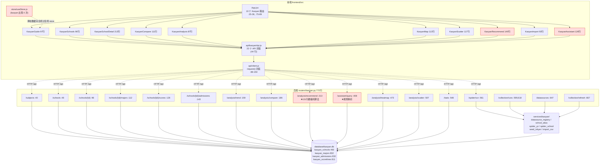
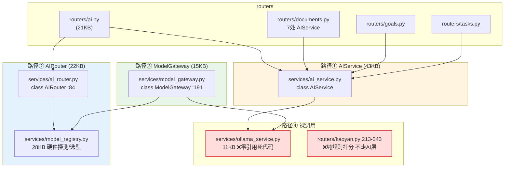
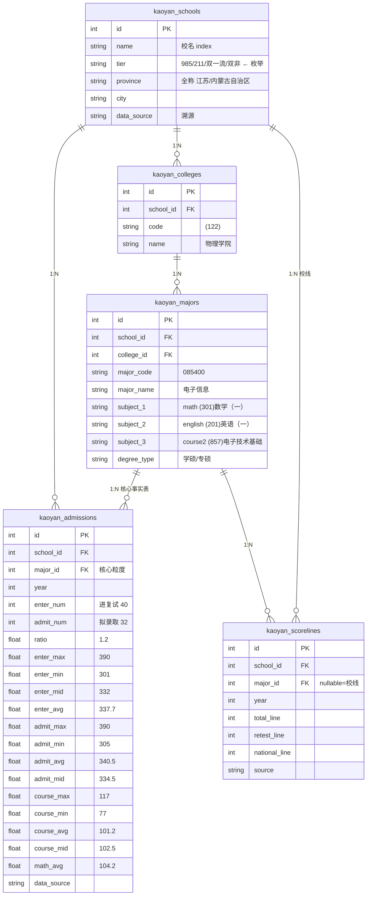
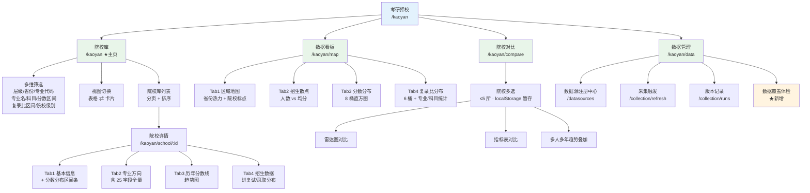
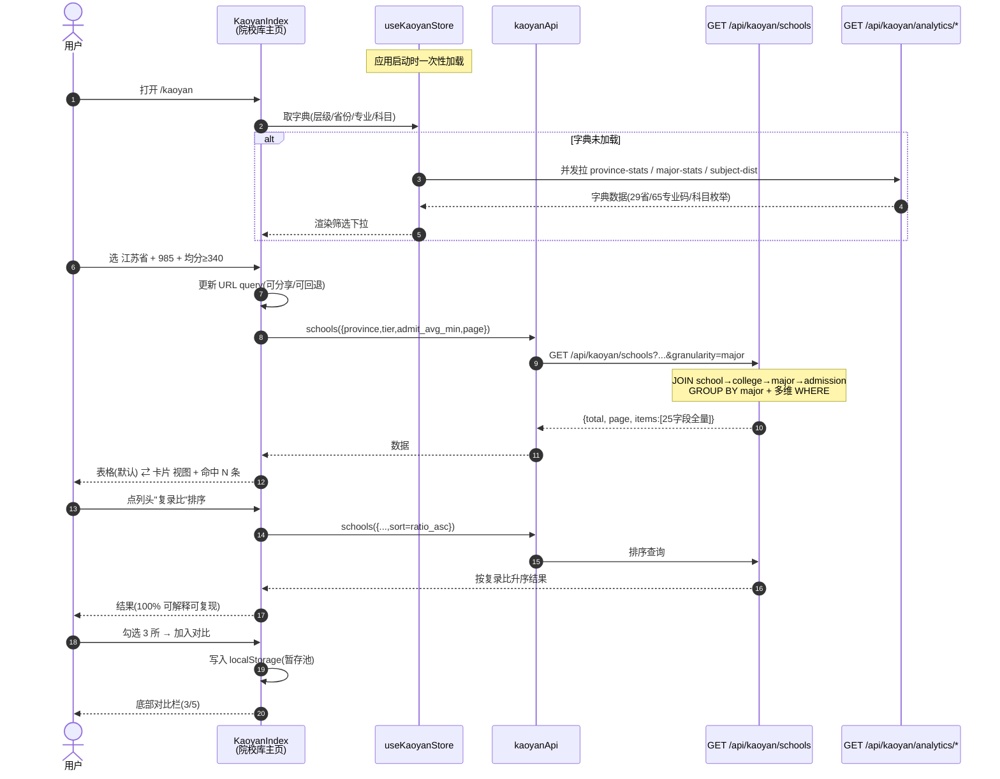

# 【深度报告】V6.0 · 架构审计与择校页面融合

> 编制：Gao（架构师）
> 日期：2026-10-09
> 范围：`D:\平台` 全栈（backend-main-fastapi + frontend/src + database/kaoyan.db）
> 性质：**只读诊断报告，未修改任何业务代码**。docs/ 下既有文件全部保留未动。

---

## TL;DR

**核心结论：这不是"功能不够"的平台，而是"缺少架构约束"的平台。混乱的根因是三个可验证的结构性缺陷，而非代码质量问题。**

1. **择校模块的数据粒度与页面形态错配（最严重）**。txkyer.cn 的原始数据是 **1115 条「学校×学院×专业」级联记录**（25 个字段，含进复试分/录取分/专业课分的 max/min/avg/mid 完整分布），而本项目的 `seed_txkyer.py` **只提取了 `name`/`level`/`province` 三个字段**，把 16 个分数维度和全部专业级信息丢弃。结果：数据库里 `research_direction`/`reference_books`/`degree_type` 三个字段填充率 **0%**，`intro` 填充率 **0%**，`city` 填充率 **0.6%**（3/493）。前端却按"数据驱动"的方向做了 10 个页面 —— **页面在等数据，数据没来**。

2. **AI 能力存在 4 条并行的调用路径，没有统一网关**。`ai_router.py`(AIRouter)、`model_gateway.py`(ModelGateway)、`ai_service.py`(AIService)、`ollama_service.py` 四套并存；实测 `ollama_service.py` **零引用（纯死代码 11048 字节）**，`ai_optimizer.py` 仅被 `/api/performance` 一个诊断端点引用。择校推荐算法（`kaoyan.py:213-343`，131 行硬编码打分）完全不走任何 AI 层，是第四套独立的"决策逻辑"。

3. **文档腐化已影响判断**。docs/ 下 5 份高度重叠的"开源借鉴"报告（V3.0/V4.0/开源方案借鉴/修改建议清单/考研平台开源借鉴深度报告.md）+ 1 份 HTML 副本，共约 400KB。独立核查 `D:\桌面\优秀项目.txt` 的 C1–F2 共 **23 条**任务：**已落地 18 / 部分落地 4 / 未落地 1**。

### 问题总数统计

| 严重度 | 数量 | 说明 |
|--------|------|------|
| **P0** | **9** | 阻断性：数据丢失、契约错误、页面不可用、AI 路径分裂 |
| **P1** | **14** | 结构性：分层混乱、重复实现、死代码、导航冗余 |
| **P2** | **13** | 质量：字段填充率、错误处理、命名、文档 |
| **P3** | **8** | 整洁度：死文件、目录散乱、日志残留 |
| **合计** | **44** | 详见第 3 节问题清单表 |

### 择校页面收敛核心结论

**10 个页面 → 4 个页面**（1 个列表/筛选 + 1 个详情 + 1 个对比 + 1 个数据管理），**删除 6 个**。
导航从 10 项压到 4 项。**移除全部 AI 推荐**（`KaoyanRecommend` 删除、`KaoyanAssistant` 删除、`assistant/query` 与 `analysis/recommend` 端点下线）。
详见第 6 节。

---

## 0. 审计方法与证据等级说明

本报告所有结论标注证据等级：

| 标记 | 含义 |
|------|------|
| ✅ **已验证** | 实际执行命令/读取文件/查询数据库得到的结果，附文件路径:行号或命令输出 |
| 🔶 **推断** | 基于已验证事实的合理推理，未直接观测 |
| ❓ **需人工确认** | 无法通过静态审计判定，需运行或产品决策 |

**审计手段**：
- 逐文件精读：`routers/kaoyan.py`(772行)、`models.py` Kaoyan* 段、`api/client.js`(23KB)、`api/kaoyanApi.js`、10 个 `Kaoyan*.jsx`、`components/EChart.jsx`、`components/Layout.jsx`
- AST 级路由提取：正则提取 29 个 router 文件的 `@router.*` 装饰器 + prefix，与前端 193 个 `request()` 调用点做双向比对
- 死代码扫描：对 `services/*.py` 全部 51 个模块做跨模块引用计数；`pages/*.jsx`/`components/*.jsx` 全量孤立检测
- 数据库实测：只读模式（`mode=ro`）查询 `database/kaoyan.db`，统计 57 张表、字段填充率、脏数据
- 外部站点实测：`curl` 抓取 `http://www.txkyer.cn/data/kaoyan_data.js`（379,987 字节），解析出完整 `columns` 定义与 1115 条 records

**未核实项**已在第 8 节单独列出。

---

## 1. 架构现状全景

### 1.1 代码规模（✅ 已验证）

| 层 | 规模 | 备注 |
|----|------|------|
| 后端 Python 文件 | 156 个 / 39,951 行 | `backend-main-fastapi/` |
| 后端 router | 29 个文件 / **250 个路由端点** | 路由总数实测 |
| 后端 service | 51 个文件 | 其中 1 个零引用死代码 |
| 前端页面 | 26 个 `.jsx` / ~15,925 行 | React 18（**非 Vue**，README:339 声称正确） |
| 择校页面 | **10 个** / 1,142 行 | 见第 6 节 |
| 择校后端 | `kaoyan.py` **772 行单文件** | 全后端第 3 大 router |
| 数据库 | 270.7 MB / 57 表 / 167,047 行 | 择校相关仅 3,452 行（**2.1%**） |
| 文档 | 24 份 .md + 1 份 .html，约 400 KB | 严重重叠 |

**关键观察**：择校模块占用了 10/26 = 38% 的页面数，但只承载 2.1% 的数据量，且其中 16 个分数维度未入库 —— **页面规模与数据规模严重倒挂**。

### 1.2 当前择校模块依赖关系（✅ 已验证）



**图例**：🔴 红框 = 问题区域（硬编码推荐算法、规则问答、择校绕过 store、两个待删页面）

### 1.3 后端 AI 层四路径并存（✅ 已验证）



**实测证据**：
- `routers/ai.py:22` `from services.ai_service import AIService`；`routers/ai.py:176` `from services.ai_router import get_ai_router` → **单文件内同时使用路径①和路径②**
- `model_gateway` 的调用方有 7 个文件（`kb.py:170`、`analysis_engine.py:100,393`、`answer_cross_check.py:123`、`error_analyzer.py:135`、`exam_builder.py:365`、`formula_service.py:233`、`supplement_answers.py:23`）→ 路径③已成主力
- `ollama_service` **零引用**：全仓 grep `ollama_service` 仅命中自身 → **死代码**
- `model_gateway.py:13` 注释自称"纯新增模块，不改动 ai_router / model_registry（红线：外科手术式改动）" → **证实是并行新增而非重构** 🔶

---

## 2. 择校数据模型对比：txkyer 原生结构 vs 本项目落地情况

### 2.1 txkyer.cn 真实数据结构（✅ 已验证，实测抓取）

抓取 `http://www.txkyer.cn/data/kaoyan_data.js` → 379,987 字节 → 解析 `window.KAOYAN_DATA`：

**顶层键（11 个）**：`records`, `columns`, `provinceStats`, `majorStats`, `schoolStats`, `scoreDist`, `ratioDist`, `courseStats`, `mathDist`, `engDist`, `meta`

**`records`：1115 条，每条恰好 25 字段**（实测 `Counter({25: 1115})`，无缺字段）

**`columns` 官方定义**（实测原样输出）：
```
province, school, college, majorCode, majorName,
enterNum, admitNum, ratio,
enterMax, enterMin, enterMid, enterAvg,
admitMax, admitMin, admitAvg, admitMid,
courseMax, courseMin, courseAvg, courseMid,
mathAvg, math, english, course2, tier
```

**`meta`**：`{total:1115, schools:222, provinces:29, majors:65, enter:42279, admit:33002}`

**关键统计**：
| 维度 | 实测值 |
|------|--------|
| 记录数 | 1115 |
| 学校数 | 222 |
| 省份数 | 29（含"内蒙古自治区""宁夏回族自治区"等**全称**） |
| 专业代码 uniq | 65 |
| 学院 uniq | 439 |
| 专业名 uniq | 236（含"(专业学位)电子信息集成电路工程(集成电路设计)"这类长尾） |
| 末字段 tier 分布 | 双非 369 / 985 337 / 211 305 / 双一流 104 |
| 省份 top5 | 江苏 130 / 北京 128 / 广东 84 / 四川 80 / 陕西 77 |

**首条记录实测**：
```json
["吉林省","东北师范大学","(122)物理学院","085400","电子信息",
 40,32,1.2, 390.0,301.0,332.0,337.7, 390.0,305.0,340.5,334.5,
 117.0,77.0,101.2,102.5,104.2,
 "(302)数学（二）","(204)英语（二）","(857)电子技术基础","211"]
```

**已内置的聚合视图**（说明 txkyer 的产品形态是纯数据看板）：
- `provinceStats` (29项)：省份 → 学校数/专业数
- `majorStats` (236项)：专业名称 → 学校数/专业数
- `schoolStats` (222项)：省份/学校/college数/enter/admit/count/avgEnter/avgAdmit/avgCourse/ratio/tier
- `scoreDist` (8桶)：`<300`:52, `300-319`:158, `320-339`:228, `340-359`:206, `360-379`:205, `380-399`:142, `400+`:72, `未知`:27
- `ratioDist` (6桶)：`1.0(等额)`:335, `1.0-1.2`:230, `1.2-1.5`:326, `1.5-2.0`:104, `2.0+`:25, `未知`:70
- `courseStats` (20项)：专业课代码 → 学校数/记录数/avgAdmit
- `mathDist` / `engDist`：数学/英语科目分布

> **结论**：txkyer 本身就是**纯数据驱动、无 AI 推荐**的形态，且已经做好了 6 类聚合统计。这与用户诉求完全一致。

### 2.2 数据丢失对比（✅ 已验证，本项目最严重问题）

`seed_txkyer.py:39-72` 的 `extract_schools_from_js()` 实现：

```python
# seed_txkyer.py:60-70
for rec in data.get("records", []):
    if not rec or len(rec) < 2: continue
    name = str(rec[1]).strip()              # ← 只取 school
    if not name or name in schools: continue
    province = str(rec[0]).strip() ...      # ← 只取 province
    level_raw = str(rec[-1]).strip() ...
    level = level_raw if level_raw in ("985","211","双一流") else None   # ← 双非被丢成 None
    schools[name] = {"name": name, "level": level, "province": province}
```

**丢失清单**：

| txkyer 字段 | 本项目是否入库 | 证据 |
|------------|--------------|------|
| `college`（学院，439 uniq） | ⚠️ 部分 —— `kaoyan_colleges` 469 行，但 `seed_txkyer` 不写 | `seed_txkyer.py` 无 `KaoyanCollege` 引用 |
| `majorCode` / `majorName` | ❌ 不由 seed 写入 | `seed_txkyer.py` 无 `KaoyanMajor` 引用 |
| `enterNum` / `admitNum` / `ratio` | ❌ 不由 seed 写入 | 同上 |
| **`enterMax/Min/Mid/Avg`（4 维）** | ❌ **完全无对应字段** | `models.py:714-733` KaoyanAdmission 无 min/mid/max |
| **`admitMax/Min/Avg/Mid`（4 维）** | ❌ **完全无对应字段** | 同上 |
| **`courseMax/Min/Avg/Mid`（4 维）** | ❌ **完全无对应字段** | 同上 |
| `mathAvg` / `math` / `english` / `course2` | ❌ 不由 seed 写入 | `kaoyan_majors.exam_subjects` 99% 有值但非此源 |
| `tier` = "双非" | ❌ **映射丢失** | `seed_txkyer.py:67` 白名单只有 985/211/双一流 |

**数据库实测后果**：

```
kaoyan_schools: 493 行
  level 分布: <NULL> 268 (54.3%) / 双非 120 / 211 56 / 985 35 / 双一流 13 / 一本 1
  city 填充:  3 / 493   (0.6%)
  intro 填充: 0 / 493   (0%)
  tags 填充:  23 / 493  (4.7%)
kaoyan_majors: 832 行
  research_direction  0 / 832  (0%)
  reference_books    0 / 832  (0%)
  degree_type         0 / 832  (0%)
```

> **`level` NULL 率 54.3% 的根因**：`data_source` 分布显示 `school_official` 268 行（爬虫所得，无层级信息）+ `seed_txkyer` 225 行。而 `seed_txkyer.py` 对 txkyer 的 369 条"双非"记录一律置 `None`。前端 `KaoyanSchools.jsx:24` 的层级筛选只有 6 个选项，**54% 的院校在任何层级下都不可选**。

### 2.3 目标数据模型设计（🟡 设计建议）

**核心原则：对齐 txkyer 的 25 字段，不发明新概念。**



**需要的 12 个新字段**（全部来自 txkyer 已有数据，无需新采集）：
`enter_max/enter_min/enter_mid` (3)、`admit_max/admit_min/admit_mid` (3)、`course_max/course_min/course_mid` (3)、`admit_num` 已有则复用、`major_code` 已有则复用 → **实际新增 9 个 admissions 字段 + major 侧 3 个科目字段**

**需要的聚合视图**（对齐 txkyer 的 6 类 stats，全部可由 SQL 生成，无需 AI）：

| 视图 | 对应 txkyer | SQL 要点 |
|------|-------------|---------|
| `v_school_stats` | schoolStats | 按 school 聚合 COUNT/AVG |
| `v_province_stats` | provinceStats | GROUP BY province |
| `v_major_stats` | majorStats | GROUP BY major_name |
| `v_score_dist` | scoreDist | 8 桶 CASE WHEN 分桶 |
| `v_ratio_dist` | ratioDist | 6 桶 CASE WHEN 分桶 |
| `v_course_stats` | courseStats | GROUP BY subject_3 |
| `v_math_dist` / `v_eng_dist` | mathDist/engDist | GROUP BY subject_1/2 |

> **收益**：一次 `seed` 重跑即可获得 1115 条专业级完整记录 + 7 个看板，**零新增采集成本**。

---

## 3. 问题清单（44 条）

> 严重度定义：**P0** = 功能不可用/数据不可逆丢失/契约错误；**P1** = 结构性混乱，抬高维护成本；**P2** = 质量缺陷；**P3** = 整洁度。

### 3.1 P0 问题（9 条）

| ID | 位置(文件:行) | 问题类型 | 证据 | 影响面 | 建议动作 |
|----|--------------|---------|------|--------|---------|
| **P0-1** | `services/kaoyan/seed_txkyer.py:39-72` | **数据不可逆丢失** | ✅ `extract_schools_from_js()` 仅取 `rec[0]/rec[1]/rec[-1]`，丢弃 22/25 字段；txkyer 实测 1115 条含完整分数分布 | 择校模块全部数据维度 | 重写为写入 `kaoyan_colleges/kaoyan_majors/kaoyan_admissions` 全字段 |
| **P0-2** | `models.py:714-733` | **数据模型缺字段** | ✅ `KaoyanAdmission` 无 `enter_max/min/mid`、`admit_max/min/mid`、`course_max/min/mid` | 无法支撑 txkyer 式分数分布展示 | 新增 9 个 Float 列 + 迁移脚本 |
| **P0-3** | `seed_txkyer.py:67` | **枚举映射丢失** | ✅ `level = level_raw if level_raw in ("985","211","双一流") else None`，txkyer 实测 369/1115 条为"双非" → 全变 NULL；DB 实测 `level` NULL 268/493 = **54.3%** | 层级筛选失效，`KaoyanSchools.jsx:24` 6 个选项覆盖不全 | 补 `"双非"`；用 `school_alias` 补齐存量 |
| **P0-4** | `frontend/src/api/client.js:205` | **契约漂移（方法错）** | ✅ 前端 `GET /goals/university/search`；后端 `routers/goals.py:123` 是 `@router.post` | 院校搜索必失败 | 前端改 POST |
| **P0-5** | `frontend/src/api/client.js:206` | **契约漂移（方法错）** | ✅ 前端 `POST /goals/strategy`；后端 `routers/goals.py:145` 是 `@router.get("/strategy")` | AI 策略必失败 | 前端改 GET |
| **P0-6** | `frontend/src/api/client.js:456` | **契约漂移（方法错）** | ✅ 前端 `exportPdf: POST /papers/${id}/export`；后端 `routers/papers.py:140` 是 `@router.get` | 试卷导出必失败 | 前端改 GET |
| **P0-7** | `routers/kaoyan.py:213-343` | **AI 路径分裂 + 硬编码算法** | ✅ 131 行内联打分（`gap_score=max(0,40-gap*0.4)` 等），绕过 AIService/AIRouter/ModelGateway 全部四层 | 择校推荐不可测/不可换模型/权重硬编码 | 按用户诉求**整体删除**（见第 6 节） |
| **P0-8** | `services/ollama_service.py`（11,048 B） | **死代码** | ✅ 全仓 grep `ollama_service` 仅命中自身，零引用 | 误导 AI 架构理解 | 删除或接入 |
| **P0-9** | `database/kaoyan.db` admissions/scorelines | **脏数据** | ✅ 各有 1 行 `year=2099`（id=831/admissions、id=810/scorelines，`data_source='csv导入:c4_sample.csv'`、`source='unverified'`） | 污染 `analysis_trend` 的 `start_year` 计算（`kaoyan.py:166`）；趋势图出现 2099 尖峰 | 删除或改 year，加 CHECK 约束 |

### 3.2 P1 问题（14 条）

| ID | 位置(文件:行) | 问题类型 | 证据 | 影响面 | 建议动作 |
|----|--------------|---------|------|--------|---------|
| **P1-1** | `routers/kaoyan.py`（772 行） | **单文件巨石 + 零分层** | ✅ 55 处 `db.query/db.add/db.commit` 直写；推荐算法、NL 解析、爬虫触发、注册中心 CRUD 全在同一文件 | 不可测、不可复用 | 拆 `routers/kaoyan/{schools,analysis,stats,collection}.py` + `services/kaoyan/` 承接逻辑 |
| **P1-2** | `routers/planner.py` / `words.py` / `documents.py` | **分层混乱（普遍）** | ✅ DB 操作密度：planner 45、words 40、documents 40、quiz 29、netdisk 27、taxonomy 21 | 全后端无 service 层边界 | 逐模块下沉到 `services/` |
| **P1-3** | 10 个 `Kaoyan*.jsx` | **页面职责重叠** | ✅ `stats()+subjects()` 在 `KaoyanGuide.jsx:11` 与 `KaoyanImport.jsx:15-16` 重复；`stats()` 又在 `KaoyanAssistant.jsx:15` 第三次 | 3 次重复请求、3 处重复 UI | 合并为单一数据源（store 或 `useKaoyanData`） |
| **P1-4** | `KaoyanMap.jsx:17` + `KaoyanScatter.jsx:16` + `KaoyanAnalysis.jsx:19` | **重复数据请求** | ✅ 三页各自 `kaoyanApi.heatmap/scatter/trend`，无共享缓存 | 同一年份切换来回 3 次请求 | 引入按 `(endpoint, year)` 的缓存 |
| **P1-5** | `store/useStore.js` | **择校完全绕过全局 store** | ✅ `grep -c kaoyan store/useStore.js api/sync.js` → `useStore.js:1`（仅字符串 `'kaoyan-archive-v1'`，见 :385）、`sync.js:0`；`App.jsx:50-52` 的 `hydrate()` 不含择校 | 状态管理双轨 | 择校接入 store 或独立 `useKaoyanStore` |
| **P1-6** | `App.jsx:75-89` | **路由/导航冗余** | ✅ `/kaoyan` 嵌套路由注册 13 条（10 择校 + plan + growth + index 重复指向 KaoyanGuide） | 导航 10 项、路由 13 条、面包屑 13 条 | 收敛为 4 页（见第 6 节） |
| **P1-7** | `Layout.jsx:47-57` | **导航项与路由不同步** | ✅ 侧栏 10 项择校，但 `KaoyanGuide` 未在侧栏（只有 `/kaoyan` index）；`KaoyanAnalysis` 在路由和面包屑(`:98`)存在但**不在侧栏** | 用户找不到分数分析页 | 导航由路由表自动生成 |
| **P1-8** | AI 四路径并存 | **架构分裂** | ✅ 见第 1.3 节图；`routers/ai.py:22` 用 AIService、`:176` 用 AIRouter | 选型/降级/监控无法统一 | 统一到 ModelGateway 单一出口 |
| **P1-9** | `services/ai_optimizer.py`（12,530 B） | **准死代码** | ✅ 全仓仅 `main.py:254` `/api/performance` 引用其 `get_ai_cache/get_perf_monitor`；`AIResponseCache/AdaptiveTimeout/RequestBatcher/StreamOptimizer/QuickAnswer`(5 类) 全无业务调用方 | 12KB 伪能力 | 接入或删除 |
| **P1-10** | `routers/customization.py:67` vs `routers/errors.py:136` | **端点语义冲突** | ✅ 两处都定义 `DELETE /links/{link_id}`；但 prefix 不同（`/api` vs `/api/errors`），语义完全不同（自定义链接 vs 错题-知识点解绑） | 命名混淆，易误改 | 前者改名 `/custom-links` |
| **P1-11** | `services/kaoyan/spider_yz.py:157-215` | **采集粒度不足** | ✅ 只 `db.add(KaoyanSchool(...))`（:202-207），从不写 `KaoyanMajor/KaoyanAdmission`；DB 实测 `majors` 832 行全部来自 CSV | C1 声称"完整爬取"未达成 | 补专业目录抓取，或明确降级为"院校名录源" |
| **P1-12** | `kaoyan_subjects` 表 | **学科字典与数据脱节** | ✅ DB 实测仅 **8 行**（`seed_txkyer.py:16-25` 的 8 个硬编码）；txkyer 实测 **65 个专业代码**；而 `kaoyan_majors.subject_code` 有 799/832 有值 → 大量 subject_code 无字典项 | 学科筛选下拉（`KaoyanGuide.jsx:50`）覆盖不全 | 从 `kaoyan_majors` 反向生成字典 |
| **P1-13** | `services/answer_rules.py:5-8` | **文档与实现不符** | ✅ docstring 声称注入 `ai.py（RAG 答疑/chat）`；实测 `grep ANSWER_RULES routers/ai.py` → **零命中**。实际仅 `analysis_engine.py:24,29,327` + `answer_cross_check.py:17,134` | 主答疑链路无答题规范约束 | 补注入或改文档 |
| **P1-14** | `components/EChart.jsx:56` | **事件监听泄漏** | ✅ `useEffect` cleanup `window.removeEventListener('resize', () => {})` 传**新函数引用**，移除无效；`:52` 注册的是具名 `handler` | 每次图表挂载泄漏 1 个 resize 监听；择校 6 个图表页放大泄漏 | cleanup 内传 `handler` |

### 3.3 P2 问题（13 条）

| ID | 位置(文件:行) | 问题类型 | 证据 | 影响面 | 建议动作 |
|----|--------------|---------|------|--------|---------|
| **P2-1** | `kaoyan_majors` 表 | 字段零填充 | ✅ `research_direction`/`reference_books`/`degree_type` 均 0/832 | 专业方向/参考书目/学硕专硕 页签全空 | 采或从 txkyer `majorName` 拆分 |
| **P2-2** | `kaoyan_schools` 表 | 字段零填充 | ✅ `intro` 0/493、`city` 3/493、`tags` 23/493 | 详情页 overview 几乎空白 | 批量补 |
| **P2-3** | `kaoyan_schools.tags` | **类型双态** | ✅ `KaoyanSchools.jsx:75` `Array.isArray(s.tags) ? s.tags.join('、') : s.tags` — 前端猜后端可能返数组或字符串 | 渲染不确定 | 后端统一为数组 |
| **P2-4** | 10 个 `Kaoyan*.jsx` | 内联样式 | ✅ 每个页面重复 `style={{padding:'24px',maxWidth:'1200px',margin:'0 auto'}}`（如 `KaoyanSchools.jsx:27`、`KaoyanCompare.jsx:48`、`KaoyanMap.jsx:68`、`KaoyanScatter.jsx:65`） | 改主题需逐页改 | 抽 `PageContainer` |
| **P2-5** | 6 个 `Kaoyan*.jsx` | 硬编码年份 | ✅ `[2026,2025,2024,2023]` 重复于 `KaoyanMap.jsx:75`、`KaoyanScatter.jsx:74`、`KaoyanRecommend.jsx:78`；后端默认 `year: int = Query(2026)`（`kaoyan.py:221,475,510`） | 2027 需改 6 处 | 由 `/api/kaoyan/stats` 的 `years` 字段驱动（已存在，`kaoyan.py:556`） |
| **P2-6** | 6 个 `Kaoyan*.jsx` | 硬编码层级 | ✅ `['985','211','双一流','一本','二本','民办']` 在 `KaoyanSchools.jsx:24`；后端 `LEVEL_NAMES` 在 `kaoyan.py:378`；DB 实际值是 `双非` 而非 `一本/二本/民办` | **三处枚举不一致** | 单一枚举源 |
| **P2-7** | `KaoyanMap.jsx:21-29` | **死代码：恒等映射** | ✅ `nameMap` 34 项全部 `'北京':'北京'` 形式，`nameMap[i.name] \|\| i.name` 恒等于 `i.name` | 误导性代码 | 删除 |
| **P2-8** | `KaoyanSchoolDetail.jsx:7-20` | **省份名硬编码** | ✅ `PROVINCE_COORDS` 34 项，键为"北京/河北"短名，而 DB 实测 province 为"湖北省/内蒙古自治区"**全称** → `PROVINCE_COORDS[school.province]` 大量 miss，fallback `[105,35]` | 院校定位图全部落到默认坐标 | 统一省份名或后端归一 |
| **P2-9** | `KaoyanCompare.jsx:53-57` | **UX 硬伤** | ✅ 需手工输入逗号分隔 ID `"1,2,3"`；`:11` 静默 `if (schools.length < 2) return` 无提示 | 对比功能实际不可用 | 改为从院校库多选 |
| **P2-10** | 全部 `Kaoyan*.jsx` | 异常静默 | ✅ 9 个页面统一 `.catch(() => {})`（如 `KaoyanGuide.jsx:13`、`KaoyanSchools.jsx:20`、`KaoyanAnalysis.jsx:21`） | 接口全挂时页面空白且无提示，用户无法区分"无数据"与"请求失败" | 统一错误态组件 |
| **P2-11** | `kaoyan.py:381-394` `_parse_question` | **正则过窄** | ✅ `r"(\d{3})\s*分"` 只认 3 位数；省份表 `PROVINCE_NAMES`(`:371-377`) 用短名"北京"而 DB 是"北京市" → `p in q` 匹配失败 | 问答引擎解析率极低 | 修枚举与正则（但该页将删除） |
| **P2-12** | `docs/`（24 份 .md） | **文档腐化** | ✅ 5 份高度重叠的开源借鉴报告：`【深度报告】开源源码级借鉴与优化V4.0.md`(115KB)、`【深度报告】考研学习平台开源方案借鉴与优化V3.0.md`(46KB)、`开源方案借鉴深度报告.md`(93KB)、`考研学习平台开源方案借鉴与优化深度报告.md`(72KB)、`考研学习平台_修改建议与开源融入清单.md`(20KB)，另有 `考研平台开源借鉴深度报告.html`(118KB) 同源副本 | 新人无法判断哪份为准；结论互相矛盾（V5.0:65 称"完成度约 60%"） | 主理人归档（本次未动） |
| **P2-13** | `kaoyan.py:191` | **静默截断** | ✅ `ids = [int(x) for x in school_ids.split(",")[:5]]` — 传 6 个静默丢弃第 6 个，无任何提示；且非数字会抛 `ValueError` → 500 | 对比页静默行为 | 显式校验 |

### 3.4 P3 问题（8 条）

| ID | 位置 | 问题类型 | 证据 | 影响面 | 建议动作 |
|----|------|---------|------|--------|---------|
| **P3-1** | `backend-main-fastapi/models/` | **空目录** | ✅ `ls` 结果为空，但 `models.py` 在上一级 → 同名歧义 | 误导文件搜索 | 删除空目录 |
| **P3-2** | `_audit_db.py`(0 B)、`_test_db.py`(0 B) | 0 字节文件 | ✅ 实测 0 字节 | 干扰 | 删除 |
| **P3-3** | `services/kaoyan/import_yz_json.py`(0 B) | 0 字节文件 | ✅ 实测 0 字节 | 干扰 | 删除 |
| **P3-4** | `scripts/diagnostics/_tmp_db_check.py`(0 B) | 临时脚本残留 | ✅ 实测 0 字节 | 干扰 | 删除 |
| **P3-5** | 后端日志/输出残留 | 运行产物入库 | ✅ `err.log`(649B)、`err2.log`(6,042B)、`p0_err.log`(753B)、`p0_out.log`(5,484B)、`server_err.txt`(700B)、`server_log.txt`(2,836B)、`_kb_health_err.txt`(0B)、`pycheck.txt`(0B) | 污染仓库 | 加 .gitignore |
| **P3-6** | 根目录 | 临时产物入库 | ✅ `temp_routes.json`(6,359B)；根目录 `exports/` 含 2 个 PDF 导出样本 + `_words_sample.json` | 污染仓库 | 移入 `_archive/` 或忽略 |
| **P3-7** | `_archive/`（11 个子目录） | **归档未清理** | ✅ `dead_dirs/oneoff_scripts/orig_backups/removed_pomodoro/removed_schedule/unused_backend-agent/unused_backend-agent-proxy/unused_frontend/unused_services/db_backups` | 历史推翻重写的痕迹仍在仓库 | 确认后删或移出仓库 |
| **P3-8** | `D:\kaoyan_ai\pipeline\`（**90 个 .py**，非本仓库） | **模块 E3 未落地** | ✅ 实测 90 个脚本；任务要求"归档整理 110 个" | AI 板块仍平行为第三套系统 | 见第 4 节 E3 判定 |

---

## 4. 开源方案落地独立核查

> 方法：对 `D:\桌面\优秀项目.txt` 模块 C/D/E/F 共 **23 条**任务逐条查代码。**判定标准**：✅已落地 = 代码存在且被实际调用；🟡部分落地 = 骨架在但不完整/未接主链路；❌未落地 = 无代码。docs 下既有报告的声称**不作为依据**。

### 模块 C：数据采集体系

| 编号 | 任务 | 判定 | 证据 |
|------|------|------|------|
| **C1** | 研招网爬虫完善（骨架→完整爬取，先前 3 省试点） | 🟡 **部分落地** | ✅ `services/kaoyan/spider_yz.py`(8,301B) 存在，`crawl()` 在 `:154`；`checkpoint.json` 实测含 `11_01`~`12_03` 等已完成省份码 → **试点确实跑过**。❌但 `:157-215` 只写 `KaoyanSchool`，**从不写专业/招生/分数线** → "完整爬取"未达成（关联 P1-11） |
| **C2** | 爬虫合规与断点续爬 | ✅ **已落地** | ✅ `spider_yz.py:69 check_robots()`（robots.txt 检查，`:102` 禁止则停止）、`:61-63 polite_delay()` → `time.sleep(random.uniform(2,5))`、`spider_yz.py:22 CHECKPOINT_FILE` + `:108 load_checkpoint` + `:118 save_checkpoint`；`spider_school.py:26 check_robots(domain)` + `:85,210,221` 三处 delay。**双爬虫均覆盖** |
| **C3** | 院校官网爬虫（复试线/拟录取 PDF 解析） | 🟡 **部分落地** | ✅ `services/kaoyan/spider_school.py`(9,778B) 存在，`:26 check_robots`、`:196-199` 合规检查、`:227-234` 写 `KaoyanScoreLine`。❌但 DB 实测 `data_source='school_official'` 有 268 行**只填了 schools 表**，`kaoyan_scorelines.source` 无 school_official 值 → **写分数线这条链路未产生数据** |
| **C4** | CSV 导入落地（校验与批量入库） | ✅ **已落地** | ✅ `services/kaoyan/import_csv.py`(9,199B)：`:111 KaoyanSchool(` `:143 KaoyanMajor(` `:171 KaoyanAdmission(` `:193 KaoyanScoreLine(`。✅**DB 证据**：`kaoyan_admissions.data_source` 100% 有值、`source` 列 832/832 有值 → 实际入库 832 条。⚠️但引入了 `year=2099` 脏数据（P0-9） |
| **C5** | 数据版本管理（按年份存储，支持历史对比与趋势分析） | 🟡 **部分落地** | ✅ 表 `kaoyan_collection_runs` 7 行；路由 `kaoyan.py:599 list_collection_runs` / `:618 create_collection_run` / `:667 collection_refresh`（支持 `dry_run`）。❌但 DB 实测 `kaoyan_admissions.year`：**2026 年 825 条 / 2025 年 6 条 / 2099 年 1 条**；`kaoyan_scorelines.year`：2026 年 788 / 2025 年 7 / 2024 年 5 / 2023 年 5 / 2022 年 5。→ **只有 2026 一年是真实批量数据，所谓"多年趋势"实际是 1 个有效点**，`KaoyanAnalysis` 趋势图（`analysis_trend` 默认 `years=5`）画出来只有 1 个点 |
| **C6** | 真题答案/解析批量补充（原 15% = 293/1869） | ✅ **已落地（且超额）** | ✅ `services/kaoyan/supplement_answers.py`(4,705B) 用 ModelGateway 批量生成；`supplement_checkpoint.json` 实测 **343 个 done_ids**。✅**DB 实测**：`quiz_questions` **1871 行**，`answer` 非空 **1871（100%）**，`analysis` 非空 **1871（100%）** → 从 15% 提升到 **100%**，超出任务目标 |

### 模块 D：前端功能增强

| 编号 | 任务 | 判定 | 证据 |
|------|------|------|------|
| **D1** | 择校推荐算法增强（复录比/录取均分/区域/学科权重） | ✅ **已落地（但按用户诉求将删除）** | ✅ `routers/kaoyan.py:213-343`，`:329-335 score_breakdown` 返回 5 维权重明细，`:342 algorithm` 返回权重串。❌问题：`:225` `subq` 注释写"按学校去重，取最低分数线"用 `func.min(total_line)` → **取最低而非最新/平均**，多专业院校分数线会被系统性低估 🔶 |
| **D2** | 院校详情页地图定位 | ✅ **已落地（有缺陷）** | ✅ `KaoyanSchoolDetail.jsx:94-131`：内嵌 ECharts `geo.map:'china'` + scatter 标点 + `:125` 百度地图外链。❌`PROVINCE_COORDS`(:7-20) 键为短名而 DB 为全称 → 大量 miss（P2-8） |
| **D3** | 择校结果关联 Goal 表 | ✅ **已落地** | ✅ `kaoyan.py:347 set_recommend_as_goal` 写 `goal.university` + `goal.total_score_target`；前端 `KaoyanRecommend.jsx:21-25 setGoal()` + `:134-141` 按钮。⚠️前端按钮将随页面删除而失效，但 Goal 写入能力可保留给"手动设目标" |
| **D4** | AI 助手集成择校问答（自然语言择校） | ✅ **已落地（但按用户诉求将删除）** | ✅ `kaoyan.py:408 assistant_query` + `_parse_question`(:381) 规则解析 + `_format_recommendations`(:397)；前端 `KaoyanAssistant.jsx` 126 行。❌`:454` 内部直接调用 `analysis_scatter(year=2026, db=db)` — **在路由内直接调另一个路由函数**，绕过 HTTP 层（耦合证据） |
| **D5** | 区域择校地图热力图（ECharts 中国地图） | ✅ **已落地** | ✅ `kaoyan.py:473 analysis_heatmap` 单次 `group_by(province)` 聚合（`:479-490`）；前端 `KaoyanMap.jsx` 113 行 + `EChart.jsx:30-40 ensureChinaMap()`；✅`frontend/public/china.json`(582,522B) 存在 |
| **D6** | 招生人数分布散点图 | ✅ **已落地** | ✅ `kaoyan.py:507 analysis_scatter` JOIN 聚合；前端 `KaoyanScatter.jsx` 117 行，按层级分 series（`:19-26 levelColor`）、气泡=复录比 |
| **D7** | 前端路由嵌套 + 懒加载 | ✅ **已落地** | ✅ `App.jsx:10-36` 全部 `React.lazy`；`:75-89` `/kaoyan` 嵌套路由 + `:43 KaoyanModuleLayout = () => <Outlet />` |
| **D8** | 导航分组调整（"择校中心"移出 AI 分组） | ✅ **已落地** | ✅ `Layout.jsx:42-43` 注释 `// D8: 择校类目归组 —— "择校中心"等考研择校入口统一归入"考研择校"类目（考研数据侧），不再挂在 AI 分组下`；✅`:46-57` 独立 `title: '考研择校'` 分组；`:59-64` AI 分组只剩 `/assistant` 一项 |

### 模块 E：平台整体工程

| 编号 | 任务 | 判定 | 证据 |
|------|------|------|------|
| **E1** | `datetime.utcnow()` 替换（29 处 → `datetime.now(UTC)`） | ✅ **已落地（超额）** | ✅ 全仓 `grep -rn utcnow --include=*.py` = **53 处命中，全部在 `models.py`**，且均为自定义 helper `_utcnow()`（`models.py:13-15` `return datetime.datetime.now(datetime.timezone.utc)`）。✅**除 `models.py` 外零 `utcnow` 残留** → 实际清理彻底（29 处 → 0 处真实弃用调用） |
| **E2** | 前端 Vitest smoke test（原 0 测试） | ✅ **已落地（偏薄）** | ✅ `package.json:11` `"test": "vitest run"`；`src/test/smoke.test.jsx`(3,210B, 3 tests) + `src/test/client.robustness.test.js`(3,374B, 8 tests)；✅`vitest.out.txt` 实测 `Test Files 1 passed (1) / Tests 3 passed (3)`。⚠️仅覆盖 Dashboard + client 封装，**26 个页面中 0 个有页面级测试** |
| **E3** | 归档诊断脚本（`kaoyan_ai/pipeline/` 110 个脚本归档整理） | ❌ **未落地** | ✅ 实测 `D:\kaoyan_ai\pipeline\*.py` = **90 个脚本，仍在原位未归档**。且 `D:\kaoyan_ai` 是**独立第三套系统**（含 `01_data_processing`/`02_dataset_construction`/`03_finetuning`/`04_app`/`sft`/`models`/`logs`），与 `D:\平台` 无代码级关联 |
| **E4** | 答题规则注入（模型 prompt 注入答题规范） | 🟡 **部分落地** | ✅ `services/answer_rules.py`(1,325B) 定义 7 条 `ANSWER_RULES`；✅实际注入 2 处：`analysis_engine.py:24 import` + `:29/:327` 拼接、`answer_cross_check.py:17 import` + `:134` 拼接。❌**`answer_rules.py:6` 声称注入 `ai.py`，实测 `routers/ai.py` 零命中** → 主答疑链路未受约束（关联 P1-13） |
| **E5** | `taxonomy.py` 扩展（EXT_SUBJECTS 支持电气/光学/计算机） | ✅ **已落地** | ✅ `services/taxonomy.py:43-58 EXT_SUBJECTS` 含"电路分析/光学/电气工程/电子科学与技术/控制科学与工程/计算机基础"及 408 细分（数据结构/操作系统/计算机网络/软件工程）；`:60 ALL_SUBJECTS = CORE + MAJOR + EXT` |
| **E6** | 入库前置校验（尺寸/DPI/格式 → invalid 清单） | ✅ **已落地** | ✅ `services/ingest_precheck.py`(5,230B)：`:24 MIN_IMAGE_DPI=100.0` / `:25 WARN_IMAGE_DPI=150.0` / `:26 DEFAULT_DPI=72.0`；`:29 _image_dpi()` 读 Pillow `im.info['dpi']`；`:45 _pdf_dpi()` 按"首页像素宽/(medibox宽pt/72)"估算；`:9-10` 文档明示写 `knowledge_base/meta/invalid_inbox.jsonl` |
| **E7** | 目录状态前缀（知识库文件状态可视化前缀） | ✅ **已落地（脚本级）** | ✅ `scripts/kb_status_tree.py`(5,636B)：`:2` 文档 `"""知识库目录状态前缀可视化（模块 E7）"""`；`:10` 四种目录级前缀 `[ALL]/[PART]/[EMPTY]/[NEW]`；`:88-89` 前缀匹配递归；`:141` 导出 `kb_status_tree.md`。⚠️**为离线脚本，未接入 Web UI** → 用户在页面上看不到前缀 |

### 模块 F：规划与成长体系补全

| 编号 | 任务 | 判定 | 证据 |
|------|------|------|------|
| **F1** | 18 节点考研规划（三层表联动：阶段→月→周→日） | ✅ **已落地** | ✅ `routers/plan.py:26 MILESTONE_SPECS` 18 节点定义（`:78` 可见"录取通知书"节点，offset_days=180）；`:94 _seed_milestones` 幂等 upsert；`:140 _build_roadmap` 构建三层；3 个端点 `:219 milestones` / generate / roadmap。前端 `kaoyanApi.js:30-32` 三封装 |
| **F2** | 成长体系四件套（等级/徽章/积分/成就） | ✅ **已落地** | ✅ `routers/growth.py:28-37` 10 级 `LEVELS`（阈值 0/100/300/600/1000/1500/2100/2800/3600/4500）；`:41 _points(stats)` 积分；`:149-151 BADGES` ≥2；`:155 _level_of`；端点 `summary`/`badges`/`achievements`/`levels` |

### 4.1 落地统计

**任务清单实际为 23 条**（C1–C6 = 6，D1–D8 = 8，E1–E7 = 7，F1–F2 = 2）。

| 判定 | 数量 | 编号 |
|------|------|------|
| ✅ 已落地 | **18** | C2, C4, C6, D1, D2, D3, D4, D5, D6, D7, D8, E1, E2, E5, E6, E7, F1, F2 |
| 🟡 部分落地 | **4** | C1, C3, C5, E4 |
| ❌ 未落地 | **1** | E3 |
| ⏰ 已过时 | **0** | — |
| **合计** | **23** | |

> 主理人任务描述中给的"22 条"为笔误；按 `优秀项目.txt:8-38` 实际清单逐条计数为 23 条，此处按实际清单统计。
> 说明：D1/D4 判定为"已落地"是指**代码确实存在并被调用**，但按用户"移除 AI 推荐"的诉求将在第 6.5 阶段删除，二者不矛盾。

**按模块分布**：

| 模块 | 已落地 | 部分落地 | 未落地 | 小计 |
|------|--------|---------|--------|------|
| **C 数据采集** | 3（C2, C4, C6） | 3（C1, C3, C5） | 0 | 6 |
| **D 前端增强** | 8（D1–D8） | 0 | 0 | 8 |
| **E 平台工程** | 5（E1, E2, E5, E6, E7） | 1（E4） | 1（E3） | 7 |
| **F 规划成长** | 2（F1, F2） | 0 | 0 | 2 |
| **合计** | **18** | **4** | **1** | **23** |

### 4.2 与既有 docs 报告的结论差异（✅ 已验证）

| 声称 | 出处 | 核查结果 |
|------|------|---------|
| "平台完成度约 60%" | `【深度报告】V5.0补充_百G支撑与入库修复.md:65` | 🔶 口径不可验证。**若按 23 条开源任务计，已落地 18 条 = 78%**，与 60% 差距大。推测 60% 是按"更大范围的方案清单"计（V4.0 提到的 6 个 proposal 方案） |
| "V4.0 的 P0 任务（打通空表）已基本完成" | 同上 `:48,65` | ✅ 大体成立。DB 实测 57 表、总 167,047 行，`knowledge_chunks` 27,893 行、`sft_examples` 4,670、`words` 4,569、`quiz_questions` 1,871、`documents` 1,846 均已填 |
| "当前答案覆盖率仅 15%（293/1869）" | `优秀项目.txt:15` (C6 任务描述) | ⏰ **已过时**。DB 实测 1871/1871 = **100%** |
| "前端 0 测试" | `优秀项目.txt:29` (E2 任务描述) | ⏰ **已过时**。实测 11 个测试（3+8） |
| "29 处 utcnow" | `优秀项目.txt:28` (E1 任务描述) | ⏰ **已过时且超额完成**。真实残留 0 处 |

---

## 5. 择校页面现状诊断

### 5.1 10 个页面职责矩阵（✅ 已验证）

| 页面 | 行数 | 调用端点 | 数据形态 | 问题 |
|------|------|---------|---------|------|
| `KaoyanGuide` | 97 | `/stats` + `/subjects` | 卡片+链接 | 与 Import 重复；纯跳转页，无实质内容 |
| `KaoyanSchools` | 96 | `/schools` | 表格 | 仅 3 个筛选项（level/province/keyword）；**与 txkyer 的 65 专业代码/29 省份维度不匹配** |
| `KaoyanSchoolDetail` | 213 | `/schools/{id}` + `/majors` + `/scores` + `/admissions`（**4 个并行**） | Tab×4 | `Promise.all`(:31-36) 任一失败则全部 `catch(()=>{})` 静默；PROVINCE_COORDS miss（P2-8） |
| `KaoyanCompare` | 111 | `/analysis/compare` | 雷达图+表格 | 需手输 ID（P2-9）；雷达图硬编码 max 450/500/420(:26-29) |
| `KaoyanAnalysis` | 87 | `/schools` + `/analysis/trend` | 折线+表格 | **侧栏无入口**（P1-7）；DB 只有 2026 一年有效数据 → 趋势图 1 个点 |
| `KaoyanMap` | 113 | `/analysis/heatmap` | 地图+省份卡 | `nameMap` 恒等死代码（P2-7） |
| `KaoyanScatter` | 117 | `/analysis/scatter` | 散点+表格 | 表格硬截断 50 条(:98, :112) |
| `KaoyanRecommend` | 149 | `/analysis/recommend` + `/set-goal` | 权重明细列表 | **AI 推荐，用户要求移除** |
| `KaoyanImport` | 93 | `/stats` + `/subjects` | 卡片+说明 | `runSeed()`(:19-22) **不调后端**，只 `setSeedStatus` 显示一行让用户去服务器手动执行的命令；`crawlStatus` state(:8) 声明后**从未使用** |
| `KaoyanAssistant` | 126 | `/assistant/query` + `aiApi.chat` | 对话 | **双重 AI**：先规则引擎再 `aiApi.chat`(:51-57) 加"AI 深度解读"；用户要求移除 |

### 5.2 重复实现量化（✅ 已验证）

| 重复项 | 出现位置 | 次数 |
|--------|---------|------|
| `/stats` 调用 | `KaoyanGuide.jsx:11`、`KaoyanImport.jsx:15`、`KaoyanAssistant.jsx:15` | **3** |
| `/subjects` 调用 | `KaoyanGuide.jsx:11`、`KaoyanImport.jsx:16` | **2** |
| `/schools` 调用 | `KaoyanSchools.jsx:18`、`KaoyanAnalysis.jsx:13` | **2** |
| 年份下拉 `[2026,2025,2024,2023]` | `KaoyanMap.jsx:75`、`KaoyanScatter.jsx:74`、`KaoyanRecommend.jsx:78` | **3** |
| 页面容器内联样式 | 6 个页面 | **6** |
| 层级枚举 | 前端 `KaoyanSchools.jsx:24` + 后端 `kaoyan.py:378` + DB 实际值 | **3 处不一致** |
| 统计卡片 UI | `KaoyanGuide.jsx:29-44`、`KaoyanImport.jsx:31-42` | **2** |
| `.catch(() => {})` 静默 | 9 个页面 | **9** |

### 5.3 数据流断裂（✅ 已验证）

```
用户访问 /kaoyan/map
  → KaoyanMap.jsx:17  kaoyanApi.heatmap({year:2026})
    → GET /api/kaoyan/analysis/heatmap
      → routers/kaoyan.py:473 analysis_heatmap
        → db.query(KaoyanSchool.province, count, avg(total_line), avg(retest_ratio))
          .outerjoin(KaoyanScoreLine, year==2026)
          .outerjoin(KaoyanAdmission, year==2026)
          .group_by(province)
        → 返回 {items:[{name,value,avg_line,avg_retest_ratio}]}
```

**断点**：`KaoyanScoreLine` DB 实测 2026 年 **788 条**、`KaoyanAdmission` 2026 年 **825 条** → 地图有数据。但：
- 返回体**不含专业级信息** → 无法做 txkyer 式"专业数"维度
- `avg_line` 用 `func.avg` 跨专业聚合 → 985 与二本被平均在一起 🔶
- 无缓存，每次切年份重查

---

## 6. 择校页面融合设计（目标架构）

### 6.1 设计原则

| # | 原则 | 落地方式 |
|---|------|---------|
| 1 | **纯数据驱动，零 AI** | 删除 `KaoyanRecommend` / `KaoyanAssistant`；下线 `/analysis/recommend` 与 `/assistant/query` |
| 2 | **对齐 txkyer 数据形态** | 25 字段直映射，7 个聚合视图 |
| 3 | **页面数量最小化** | 10 → 4 页；导航 10 → 4 项 |
| 4 | **一次请求，多处复用** | 择校数据进 store；筛选条件进 URL query（可分享/可回退） |
| 5 | **每阶段可独立验收** | P0/P1/P2 三阶段，每阶段结束即可交付 |

### 6.2 页面收敛方案

| 原页面 | 处置 | 目标页面 | 说明 |
|--------|------|---------|------|
| `KaoyanGuide` | **删除** | — | 纯跳转卡片页，价值为零；导航直接进 `/kaoyan` |
| `KaoyanSchools` | **改造为** | **`/kaoyan` 院校库**（主页） | 加多维筛选 + 卡片/表格双视图 |
| `KaoyanSchoolDetail` | **改造为** | **`/kaoyan/school/:id`** | 增加分数分布区间条 |
| `KaoyanCompare` | **改造为** | **`/kaoyan/compare`** | 改为从院校库多选（带 localStorage 暂存） |
| `KaoyanAnalysis` | **并入** | 院校库"分数趋势"Tab + 详情页 | 复用 `trend` 端点，不单独成页 |
| `KaoyanMap` | **并入** | **`/kaoyan/map`**（保留独立，数据可视化独立价值） | 扩展为 txkyer 6 类统计看板 |
| `KaoyanScatter` | **并入** | **`/kaoyan/map` 的 Tab** | 同上，避免独立页 |
| `KaoyanImport` | **改造为** | **`/kaoyan/data`** 数据管理 | 保留数据源/采集/版本，接真实后端端点 |
| `KaoyanRecommend` | ❌ **删除** | — | 用户明确要求移除 AI 推荐 |
| `KaoyanAssistant` | ❌ **删除** | — | 用户明确要求移除 AI 问答 |

**结果：10 页 → 4 页**

| 目标路由 | 页面 | 数据来源 |
|---------|------|---------|
| `/kaoyan` | 院校库（多维筛选 + 列表/卡片） | `/schools`（增强） |
| `/kaoyan/school/:id` | 院校详情（4 Tab + 分数分布） | `/schools/{id}` 系列 |
| `/kaoyan/compare` | 院校对比（多选 + 雷达/表格） | `/analysis/compare`（增强） |
| `/kaoyan/map` | 数据看板（地图/散点/分布/专业 4 Tab） | `/analysis/heatmap` + `/scatter` + 新 5 个视图 |
| `/kaoyan/data` | 数据管理（数据源/采集/版本） | `/datasources` + `/collection/runs` + `/collection/refresh` |

> 实际 5 条路由（4 个功能页 + 详情页），导航侧栏展示 4 项（详情页不在导航）。

### 6.3 信息架构（IA）



### 6.4 统一数据层设计

**后端新增（`routers/kaoyan/analytics.py`）** — 纯聚合，无 AI：

| 端点 | 对应 txkyer | 返回 |
|------|-------------|------|
| `GET /api/kaoyan/analytics/overview` | `meta` | `{schools, provinces, majors, colleges, records}` |
| `GET /api/kaoyan/analytics/school-stats` | `schoolStats` | `[{province, school, tier, college_count, record_count, avg_enter, avg_admit, avg_course, avg_ratio}]` |
| `GET /api/kaoyan/analytics/province-stats` | `provinceStats` | `[{province, school_count, major_count}]` |
| `GET /api/kaoyan/analytics/major-stats` | `majorStats` | `[{major_name, school_count, record_count}]` |
| `GET /api/kaoyan/analytics/score-dist` | `scoreDist` | `{buckets:[{range,count}], total}` |
| `GET /api/kaoyan/analytics/ratio-dist` | `ratioDist` | `{buckets:[{range,count}], total}` |
| `GET /api/kaoyan/analytics/course-stats` | `courseStats` | `[{course_code, course_name, school_count, record_count, avg_admit}]` |
| `GET /api/kaoyan/analytics/subject-dist?field=math\|english\|course2` | `mathDist`/`engDist` | `[{subject, count}]` |
| `GET /api/kaoyan/analytics/coverage` | — | ★新增：字段填充率体检（替代 KaoyanImport 的静态文案） |

**`/api/kaoyan/schools` 需增强的筛选参数**：

| 参数 | 类型 | 对应 txkyer 维度 |
|------|------|-------------------|
| `tier` | enum | 末字段（补齐"双非"） |
| `province` | str | 字段 0 |
| `major_code` | str | 字段 3（**已支持 `subject_code`，需改名为 `major_code` 或并存**） |
| `major_name` | str | 字段 4 |
| `subject_math` / `subject_english` / `subject_course` | str | 字段 21/22/23 |
| `admit_avg_min` / `admit_avg_max` | float | 字段 14 |
| `ratio_min` / `ratio_max` | float | 字段 7 |
| `enter_num_min` | int | 字段 5 |
| `sort` | enum | `admit_avg`/`ratio`/`enter_num`/`school_count` |
| `page_size` | int ≤ 100 | （已有，`:56` 上限 100） |

**粒度切换设计（关键决策）**：

```
默认粒度 = 专业级（major）
理由：txkyer 1115 条记录本身就是专业级，且分数数据挂在专业上
提供 ?granularity=school 切换为院校级聚合（GROUP BY school_id）
```

> 这直接解决当前 `KaoyanSchools` 只能看院校名、看不到"哪些专业招人"的核心痛点。

**前端数据层**：

```
frontend/src/
├── api/
│   ├── client.js           （不动）
│   └── kaoyanApi.js        （扩展至 ~60 行，覆盖 5 页全部端点）
├── hooks/
│   └── useKaoyanData.js    ★新增：统一筛选状态 + URL sync + 请求去抖
└── store/
    └── useKaoyanStore.js   ★新增：学科字典/省份字典/层级枚举（单一时点加载，全站复用）
```

**筛选条件 → URL 同步**（可分享、可回退、可刷新保持）：
```
/kaoyan?province=江苏省&tier=985&major_code=085400&admit_avg_min=340&sort=ratio_desc
```

### 6.5 移除 AI 推荐后的处置（用户明确诉求）

| 对象 | 处置 | 理由 |
|------|------|------|
| `KaoyanRecommend.jsx`(149行) | **删除** | 用户要求移除 AI 推荐 |
| `KaoyanAssistant.jsx`(126行) | **删除** | 用户要求纯数据驱动 |
| `GET /api/kaoyan/analysis/recommend`(`kaoyan.py:213-343`) | **下线** | 唯一调用方是待删页面 |
| `POST /api/kaoyan/analysis/recommend/{id}/set-goal`(`kaoyan.py:347-367`) | **保留并迁移** | Goal 关联能力有价值，改为详情页"设为目标院校"按钮调用 |
| `POST /api/kaoyan/assistant/query`(`kaoyan.py:408-469`) | **下线** | 唯一调用方是待删页面 |
| `_parse_question`(`kaoyan.py:381-394`) | **删除** | 随端点下线 |
| `_format_recommendations`(`kaoyan.py:397-405`) | **删除** | 同上 |
| `PROVINCE_NAMES` / `LEVEL_NAMES`(`kaoyan.py:371-378`) | **复用** | 迁到 `services/kaoyan/constants.py` 作为筛选枚举单一来源 |
| `/api/performance` 中的 AI 缓存（`main.py:254`） | **不动** | 与择校无关 |

**替代能力（纯数据）**：原"智能推荐"的核心价值是"给定分数找适配院校"。移除 AI 后用**确定性筛选 + 排序**替代：

```
用户输入预估分 350
  → /kaoyan?admit_avg_min=340&admit_avg_max=380&sort=ratio_asc
  → 按复录比升序（竞争最小）排序列出，结果 100% 可解释、可复现
```

这比 AI 黑盒推荐更符合"数据仅供参考"的产品定位，且**零维护成本**。

### 6.6 分阶段迁移路径

#### P0 阶段：数据地基 + 契约修复（可独立验收）

| 任务 | 交付物 | 验收标准 |
|------|-------|---------|
| P0-1 新增 9 个分数分布字段 | `models.py` + 迁移脚本 | `PRAGMA table_info(kaoyan_admissions)` 含 enter_max/min/mid, admit_max/min/mid, course_max/min/mid |
| P0-2 重写 seed 导入 | `services/kaoyan/import_txkyer.py` | 重跑后 `kaoyan_admissions` ≥ 1115 行且 16 个分数字段填充率 > 90% |
| P0-3 修复 tier 枚举 | 补"双非" + 存量回填 | `level IS NULL` 占比 < 5% |
| P0-4 清理脏数据 | 删 `year=2099`，加 CHECK | `SELECT COUNT(*) WHERE year>2100` = 0 |
| P0-5 修 3 处契约漂移 | `client.js:205,206,456` | 自动化契约测试全绿 |
| P0-6 建契约回归测试 | `tests/test_api_contract.py` 扩展 | 自动比对前端 api 层与后端路由，漂移即失败 |

**P0 验收命令**：`python -m pytest tests/ -q` 全绿 + 上述 6 条 SQL 检查全通过。

#### P1 阶段：页面收敛（可独立验收）

| 任务 | 交付物 | 验收标准 |
|------|-------|---------|
| P1-1 新增 analytics 端点 | `routers/kaoyan/analytics.py`(9 端点) | 9 个端点返回结构与 txkyer 6 类 stats 对齐 |
| P1-2 增强 `/schools` 筛选 | 新增 8 个查询参数 | 组合筛选可用且走索引（`EXPLAIN QUERY PLAN` 无全表扫描） |
| P1-3 建 `useKaoyanStore` | 字典类单例加载 | 切页不再重复请求 `/subjects` |
| P1-4 院校库主页 | `pages/KaoyanIndex.jsx` | 多维筛选 + 表格/卡片双视图 + URL sync |
| P1-5 数据看板页 | `pages/KaoyanBoard.jsx`（4 Tab） | 4 个 Tab 全可用，无 AI 介入 |
| P1-6 对比页改造 | `pages/KaoyanCompare.jsx` 重写 | 多选交互，≤5 所校验 |
| P1-7 详情页增强 | `KaoyanSchoolDetail.jsx` + 分布区间条 | 16 个分数维度可见 |
| P1-8 路由收敛 | `App.jsx` + `Layout.jsx` | 导航 4 项，无孤立页（每页可达） |
| P1-9 设目标院校迁移 | 详情页按钮 | 复用 `/set-goal` |

**P1 验收标准**：
- 侧栏择校区 4 项，每项可达，无死链
- 10 页 → 4 页（+1 详情），总代码行数不增加
- 全站 `/subjects` 请求数 = 1（启动时）

#### P2 阶段：工程收尾（可独立验收）

| 任务 | 交付物 | 验收标准 |
|------|-------|---------|
| P2-1 `kaoyan.py` 拆分 | `routers/kaoyan/{schools,analysis,stats,collection}.py` + `services/kaoyan/` | 单文件 < 300 行；router 层零业务逻辑 |
| P2-2 AI 四路径统一 | 全部改走 ModelGateway | `ollama_service.py` 删除；`ai_optimizer.py` 接入或删 |
| P2-3 修 P1-13 / P1-14 | ai.py 注入 ANSWER_RULES；EChart cleanup | 答题规范覆盖主链路；无监听泄漏 |
| P2-4 死代码清理 | P3-1~P3-7 全部处理 | 0 个 0 字节文件；`.gitignore` 覆盖日志/临时产物 |
| P2-5 测试补齐 | 4 个核心页 page-level 测试 | vitest ≥ 25 tests，覆盖 5 页 |
| P2-6 择校性能基线 | 契约测试 + 基准脚本 | 列表页 P95 < 300ms（1115 条规模） |

---

## 7. 核心流程时序（融合后目标态）

### 7.1 院校库多维筛选（替代原「智能推荐」）



### 7.2 数据看板（4 Tab，全部纯聚合）

```mermaid
sequenceDiagram
    autonumber
    actor U as 用户
    participant B as KaoyanBoard
    participant E as EChart
    participant A1 as /analytics/province-stats
    participant A2 as /analytics/score-dist
    participant A3 as /analytics/ratio-dist
    participant A4 as /analytics/course-stats

    U->>B: 打开 /kaoyan/map
    B->>E: ensureChinaMap() → fetch /china.json (582KB)
    E-->>B: registerMap('china')

    par Tab1 区域地图(默认)
        B->>A1: GET /analytics/province-stats
        A1-->>B: [{province, school_count, major_count}]
        B->>E: series.type='map' + visualMap
        E-->>U: 省级热力图 + 明细卡片
    and Tab2 招生散点
        U->>B: 切 Tab2
        B->>A2: (复用 /analysis/scatter)
        A2-->>B: [{name,tier,enroll,admit_avg,ratio}]
        B->>E: series.type='scatter' 按 tier 分组
        E-->>U: 气泡图(大小=复录比)
    and Tab3 分数分布
        U->>B: 切 Tab3
        B->>A2: GET /analytics/score-dist
        A2-->>B: {buckets:[<300:52, 300-319:158, ...]}
        B->>E: series.type='bar'
        E-->>U: 8 桶直方图(与 txkyer scoreDist 同构)
    and Tab4 复录比 + 科目
        U->>B: 切 Tab4
        B->>A3: GET /analytics/ratio-dist
        B->>A4: GET /analytics/course-stats
        A3-->>B: {buckets:[1.0(等额):335, ...]}
        A4-->>B: [{course_code, school_count, avg_admit}]
        B->>E: 双图 + 专业课 TOP20 表
        E-->>U: 复录比分布 + 专业课排行

    Note over B,E: 全程无 AI 介入<br/>纯 SQL GROUP BY 聚合
```

---

## 8. 未核实 / 需人工确认项

| # | 事项 | 原因 | 建议动作 |
|---|------|------|---------|
| 1 | `http://www.txkyer.cn/` **首页 UI 形态**未直接核实 | ✅ 已抓取 `data/kaoyan_data.js`（379,987 B）并解析出完整结构；但**首页 HTML/JS 交互逻辑抓取失败**（WebFetch 报 `fetch failed`），无法确认其筛选器交互、卡片布局、分页方式 | 人工浏览器打开 txkyer.cn 核对 UI，据此微调 6.4 的筛选器设计 |
| 2 | 择校数据 268 行 `school_official` 的真实来源与质量 | ✅ 已确认 `data_source='school_official'` 且 `level` 全 NULL；无法确认是哪个爬虫、哪些院校官网 | 查 `kaoyan_collection_runs` 的 source 分布，确认 C3 实际覆盖范围 |
| 3 | `_archive/` 11 个子目录是否含仍需的代码 | ✅ 已确认目录存在及命名（`dead_dirs`/`unused_*`/`removed_*`）；未逐个比对内容 | 主理人决定归档/删除策略（本次未动） |
| 4 | `D:\kaoyan_ai` 是否应并入主平台 | ✅ 确认是独立第三套系统（90 个 pipeline 脚本 + 4 个阶段目录）；其业务价值与代码质量未审计 | 产品决策：合并 or 独立 or 废弃 |
| 5 | `D:\真题（公共课）` 内容与入库情况 | 未审计（超出本次范围） | 需 PM/主理人明确是否纳入择校数据层 |
| 6 | 后端 `2026` 硬编码是否与业务时间线冲突 | ✅ 已确认 6 处硬编码（P2-5）；但"2026 年考研数据"是否为本项目目标周期，未核实 | 确认目标考研年份后统一改为配置 |
| 7 | `temp_routes.json`(6,359B) 内容 | ✅ 确认存在且未清理；内容未读 | 主理人决定去留 |
| 8 | `models/` 空目录是否被外部脚本依赖 | ✅ 确认为空；`models.py` 在上一级 | 直接删除前建议全盘搜索是否有脚本写 `models/` 路径 |

---

## 9. 行动建议优先级

### 立即可做（不动架构，收益最大）

| 序 | 动作 | 依据 |
|----|------|------|
| 1 | **重跑 txkyer 全字段导入** | P0-1/P0-2/P0-3：1115 条完整记录，零新增采集成本，激活所有择校页面 |
| 2 | **修 3 处契约漂移** | P0-4/5/6：3 行代码，3 个必然失败的功能 |
| 3 | **删 `ollama_service.py`** | P0-8：11KB 零引用死代码 |
| 4 | **清 `year=2099` 脏数据** | P0-9：污染趋势图 |
| 5 | **修 EChart 监听泄漏** | P1-14：1 行，择校 6 个图表页都受影响 |

### 择校融合（P0→P1→P2，见 6.6）

### 架构收尾（P1/P2 并行）

按依赖顺序：`kaoyan.py` 拆分 → AI 四路径统一 → 死代码清理 → 测试补齐

---

## 附录 A：核查命令清单（可复现）

```bash
# 路由/契约
grep -rhoE '@router\.(get|post|put|delete|patch)\("[^"]+"' routers/*.py | wc -l
grep -rn "utcnow" --include=*.py . | grep -v "models.py" | wc -l          # 期望 0

# 死代码
for f in services/*.py; do b=$(basename "$f" .py); [ "$b" = "__init__" ] && continue; \
  n=$(grep -rl "\b$b\b" --include=*.py routers/ services/ main.py | grep -v "services/$b.py$" | wc -l); \
  [ "$n" -eq 0 ] && echo "DEAD: $f"; done

# 页面重复
grep -c "kaoyanApi.stats()\|kaoyanApi.subjects()" pages/Kaoyan*.jsx

# 数据库（只读）
python -c "import sqlite3;c=sqlite3.connect('file:database/kaoyan.db?mode=ro',uri=True);\
print(c.execute('SELECT level,COUNT(*) FROM kaoyan_schools GROUP BY 1').fetchall())"

# txkyer 数据结构
curl -s http://www.txkyer.cn/data/kaoyan_data.js -o /tmp/k.js
python -c "import json,re;s=open('/tmp/k.js',encoding='utf-8').read();\
d=json.loads(re.search(r'window\.KAOYAN_DATA\s*=\s*(\{.*\})',s,re.S).group(1));\
print(d['columns']);print(len(d['records']))"
```

## 附录 B：本次审计未修改的文件

- **未修改任何业务代码**（backend-main-fastapi / frontend/src / database）
- **未删除或改写 docs/ 下任何既有文件**（24 份 .md + 1 份 .html 全部保留）
- **未触碰 `_archive/`**
- 临时审计脚本（`_audit_contract_tmp.py` 等 4 个）已创建并**已删除**
- 根目录原有的 `_audit_db.py`(0B)、`_test_db.py`(0B) 保持原状（属 P3-2，建议由主理人处理）
