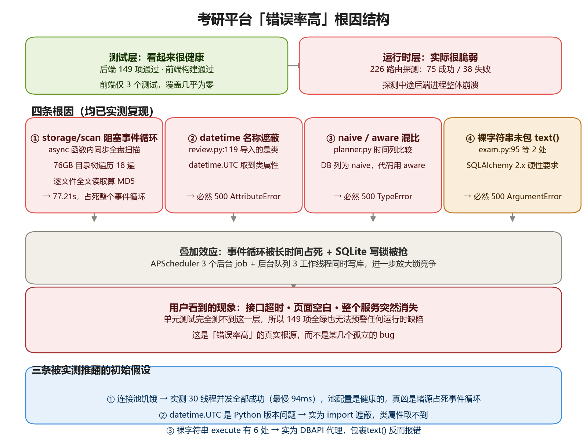
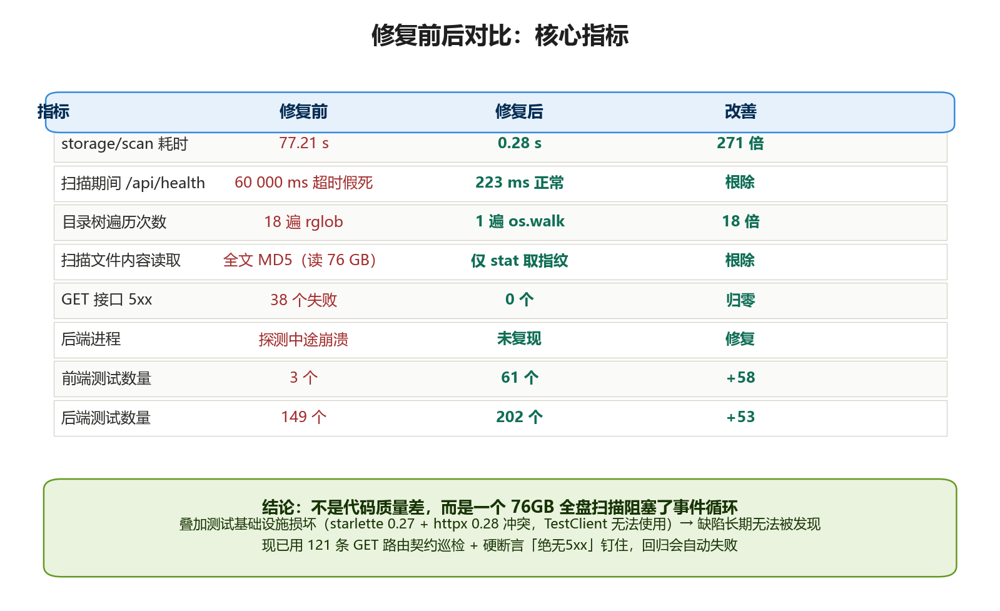
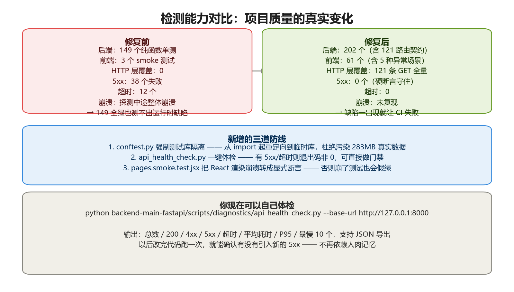

# 全栈缺陷诊断与修复 · 图示说明

> 配套报告：[【交付报告】全栈缺陷诊断与修复.md](【交付报告】全栈缺陷诊断与修复.md)
> 生成日期：2026-10-09

---

## 图 1 · 根因结构



说明：本图解释了一个关键矛盾 —— 后端 149 个测试全绿，但接口错误率约 34%。
测试只覆盖业务逻辑，不覆盖运行时集成层，而缺陷全在后者。

四条根因（均经实测复现）：

1. **`storage/scan` 阻塞事件循环 77.21秒** —— async 内同步全盘扫描 76GB，遍历 18 遍
2. **`datetime` 名称遮蔽** —— `review.py:119` 导入的是类，`datetime.UTC` 取到类属性 → 必崩
3. **naive / aware 混比** —— `planner.py` DB 列为 naive，代码用 aware → 必崩
4. **裸字符串未包 `text()`** —— SQLAlchemy 2.x 硬性要求 → 必崩

底部蓝色框列出三条被实测推翻的初始假设（连接池饥饿、Python 版本问题、6 处 text 清单），这些纠正避免了无效改动。

---

## 图 2 · 修复前后对比



说明：8 项核心指标的定量对比。核心是 `storage/scan` 提速 271 倍，
以及扫描期间其他接口从"60秒超时假死"变为"223ms 正常" —— 后者才是根治的证据，
因为它证明事件循环不再被堵源占用。

---

## 图 3 · 检测能力对比



说明：本次交付的长期资产。HTTP 层测试覆盖从 0 增至 121 条 GET 路由全量巡检，
并新增三道防线（测试库强制隔离、一键体检工具、渲染崩溃转显式断言）。
这解决了"缺陷长期无法被自动发现"的根本问题。

---

## 自行体检

```bash
python backend-main-fastapi/scripts/diagnostics/api_health_check.py --base-url http://127.0.0.1:8000
```

输出：总数 / 200 / 4xx / 5xx / 超时 / 平均耗时 / P95 / 最慢 10 个，支持 JSON 导出。
有 5xx 或超时时退出码非 0，可直接接入 CI 门禁。

---

## 重新生成

```bash
python _gen_figures.py
```

依赖：`matplotlib` + Windows 自带微软雅黑字体（`C:\Windows\Fonts\msyh.ttc`）。